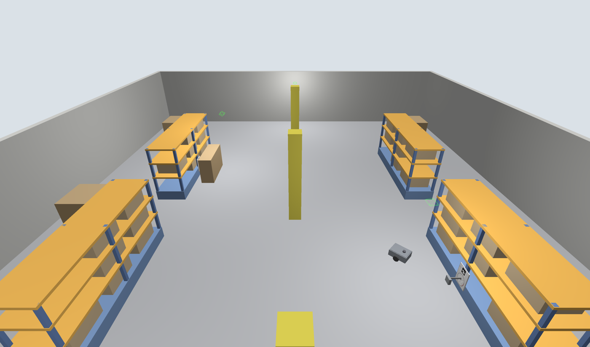

# InspectLoop — Uncertainty-Aware Autonomous Gauge Inspection Robot

[](https://github.com/Tamer1020/InspectLoop/actions/workflows/ci.yml)
  

A differential-drive mobile robot that patrols a simulated industrial warehouse, **reads analog
pressure gauges with OpenCV, estimates how far each reading can be trusted, and — when an
observation is unreliable — autonomously decides to look again, drive to a better viewpoint with
Nav2, or honestly report that no valid reading is possible.**

```
observe ──► value ± σ + quality flags ──► decision policy
   ▲                                         ├─ ACCEPT      → record value (+ heuristic σ), check alarm limits
   │                                         ├─ RETRY_SAME  → transient problem: observe again
   └──────── Nav2 ◄── viewpoint planner ◄────┼─ MOVE_NEW    → geometric problem: new pose
                                             └─ UNRESOLVED  → no reliable reading within budget
```

| Frontal view: dial hidden by a hanging conduit box → **MOVE_NEW** | Robot drove to −45° (v1 run) → reading 6.79 bar (truth 6.80) |
|---|---|
|  |  |



## Verified demo result (V3, after the second independent review; Gazebo Harmonic, headless)

| Gauge | Situation | Decisions | Reported | Truth |
|---|---|---|---|---|
| PG-11 | clear | ACCEPT | 4.21 bar (σ_h 0.05) | 4.20 |
| PG-12 | conduit box in front of the dial (invisible to the 2-D LiDAR) | MOVE_NEW → ACCEPT at −45° | 6.84 bar (σ_h 0.08) | 6.80 |
| PG-13 | crate stack in front of the gauge | RETRY_SAME / MOVE_NEW over 3 viewpoints → **UNRESOLVED** (`INSUFFICIENT_VISUAL_EVIDENCE`) | no value | 3.10 |
| PG-14 | above alarm limit | ACCEPT, **alarm HIGH** | 8.68 bar (σ_h 0.05) | 8.70 |

Run `docs/evidence/demo_run_v3/` (launch exit 0): max |error| of accepted readings 0.037 bar,
0 incorrect acceptances, result ages 0.2–0.8 s when consumed. σ_h is a **heuristic** uncertainty
indicator, not a calibrated probability — no confidence level is claimed.

**V3 changes** (independent review of V2, see
[docs/ASTRA_V3_REMEDIATION_REPORT.md](docs/ASTRA_V3_REMEDIATION_REPORT.md)): the C++ motion gate
now requires the LiDAR to *observe* the corridor swept by each motion direction (a NaN-blind
front sector no longer counts as free space; reverse and rotation are checked too); Nav2 goals are
owned from the moment they are sent, so an interrupt during goal acceptance can no longer orphan a
goal; results carry clock epochs, an age limit at consumption and fresh-odometry settle checks;
system faults are typed instead of being reported as missing images; report links survive moving
a run directory; a merged-distractor false acceptance is rejected by a physical lobe-width bound.
On a test set frozen before any change (400 synthetic bursts) V3 accepts 208/400 with 0 incorrect
acceptances (clean 189/204, difficult 19/158, out-of-scale 0/38) — identical to V2 on that set:
the new bound (which rejects the reviewed false acceptance on the development set) changed no
decision there, i.e. it cost no yield.
Earlier results: [docs/ASTRA_FIX_REPORT.md](docs/ASTRA_FIX_REPORT.md) (V2),
[docs/TEST_RESULTS.md](docs/TEST_RESULTS.md), [docs/KNOWN_LIMITATIONS.md](docs/KNOWN_LIMITATIONS.md).

## What is inside

| Package | Highlights |
|---|---|
| `inspectloop_description` | Xacro diff-drive robot, computed inertias, 2-D GPU LiDAR, RGB camera, REP-103 frames |
| `inspectloop_gazebo` | Warehouse world, gauge panels, occluders and the Nav2 map **generated from one layout file**; ros_gz bridges (LiDAR/camera in separate processes for fault injection); supervised `gz sim` |
| `inspectloop_navigation` | AMCL + Nav2 (MPPI) parameters, map, RViz config |
| `inspectloop_safety` (C++17) | `cmd_vel_gate`: last-line safety filter (LiDAR loss/invalid scans, per-direction sector coverage, stale command, obstacle corridors front/rear, turning radius, e-stop); `health_monitor`: stream rate/age + TF diagnostics |
| `inspectloop_vision` | Gauge reader: ArUco → homography → rectification → **bezel ellipse refinement** → needle angle; σ model + quality flags; ROS service with fresh-frame bursts |
| `inspectloop_mission` | Decision policy, map-aware viewpoint planner, Nav2 action-client mission manager, JSON/Markdown/HTML reports, ground-truth evaluator |
| `inspectloop_interfaces` | `GaugeReading`, `GaugeDecision`, `MissionStatus`, `ReadGauge` |
| `inspectloop_bringup` | One launch file for everything |

Architecture, node graph, TF tree, QoS and design decisions: [docs/ARCHITECTURE.md](docs/ARCHITECTURE.md).

## Quick start

```bash
# Ubuntu 24.04 + ROS 2 Jazzy + Nav2 + ros_gz (see docs/SETUP.md)
cd ~/InspectLoop
source /opt/ros/jazzy/setup.bash
colcon build --symlink-install && source install/setup.bash
colcon test && colcon test-result --verbose

# full demo with Gazebo GUI + RViz
ros2 launch inspectloop_bringup inspectloop.launch.py
# headless, exits when the mission is done
ros2 launch inspectloop_bringup inspectloop.launch.py headless:=true rviz:=false exit_on_mission_end:=true
# results
ls ~/inspectloop_runs/ && ros2 run inspectloop_mission evaluate_run ~/inspectloop_runs/<mission_id>
```

More: [docs/RUN_DEMO.md](docs/RUN_DEMO.md) · [docs/TROUBLESHOOTING.md](docs/TROUBLESHOOTING.md)

## How the robot decides

* **Reading** – once odometry shows the robot at rest, 5 frames stamped after the request
  (+0.5 s settle, never future-dated, captured at the requested viewpoint per TF) are read
  independently: on 16 rings the needle must be one lobe of the predicted width at a consistent
  angle, with no competing line and no dark structure a tapered-needle model can't explain.
  value = median; heuristic σ_h² = (1.25·spread/√n)² + σ_res² + 0.03².
* **Flags** – `OCCLUDED`, `OBLIQUE_VIEW`, `TOO_FAR`, `LOW_NEEDLE_CONTRAST`, `AMBIGUOUS_NEEDLE`,
  `NEEDLE_PARTIAL`, `TAG_NOT_VISIBLE`, `TAG_INTERMITTENT`, `INCONSISTENT_FRAMES`, `BLURRED`,
  `NO_IMAGE`, `OUT_OF_SCALE`, `FROZEN_FRAMES`, `CLOCK_RESET`, `WRONG_VIEWPOINT`, `ROBOT_MOVING`,
  `STALE_OBSERVATION`, `INVALID_FRAMES`, `PROCESSING_ERROR`, `SERVICE_FAILURE`; every gauge
  result also has a typed `outcome_class` (measured / insufficient visual evidence / camera
  unavailable / image invalid / system fault / navigation failure).
* **Policy** – ACCEPT only if the measurement contract holds (finite value inside the printed
  scale, finite positive σ_h ≤ 0.15 bar, ≥ 3 valid frames, no flag); transient-looking
  problems → RETRY_SAME (once per pose); geometric problems → MOVE_NEW with a hint
  (`different_side` / `frontal` / `closer`); camera fault or budget spent (3 viewpoints / 8
  observations) → UNRESOLVED.
* **Viewpoints** – 15 candidates (1.2/1.5/1.9 m × 0°/±30°/±45°) filtered for footprint clearance
  on the occupancy map (Nav2 reachability is *not* pre-checked; a failed goal moves on to the next
  candidate); occluded directions are blocked at every distance. Occlusion is *discovered by
  looking*, not predicted from the 2-D map.

## Honest scope

This is a simulation portfolio project. The dial is located with a printed fiducial, the imagery is
rendered (no glare/blur/distortion), thresholds are hand-set and the σ model is a heuristic that was
checked — not statistically validated — against synthetic ground truth. The C++ gate is a simulated
safety and health guard, not a certified safety function. Live ROS 2 / Gazebo results are
developer-reported from this machine (archived logs and records); the independent reviewer
re-ran the ROS-independent tests and evaluations but not the simulation. See
[KNOWN_LIMITATIONS](docs/KNOWN_LIMITATIONS.md).

## License

Apache-2.0 — see [LICENSE](LICENSE).
