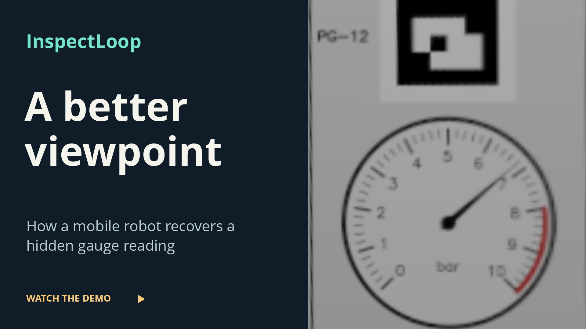
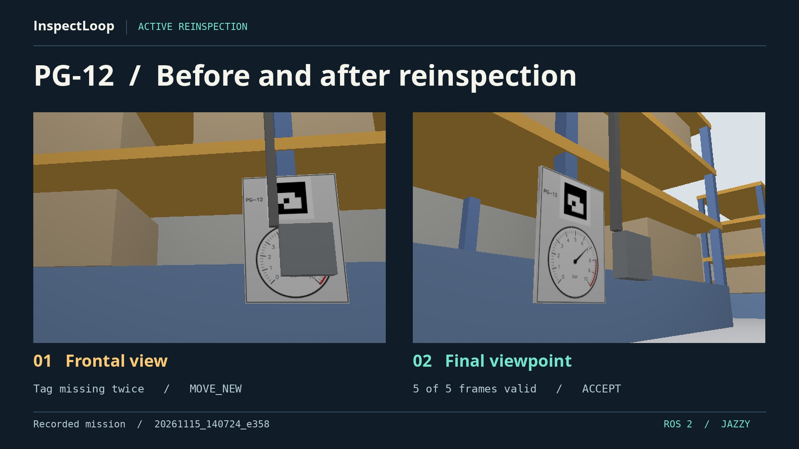
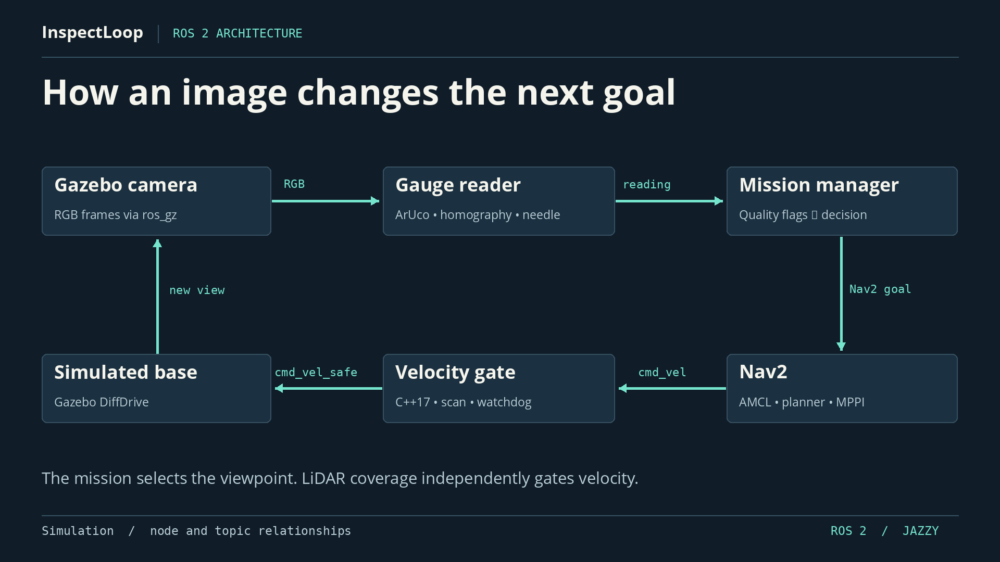

# InspectLoop

A mobile robot inspects pressure gauges in a simulated warehouse. When a conduit hides the dial, the robot can request a new Nav2 viewpoint, take a fresh camera observation and decide whether to record a pressure.

[](https://github.com/Tamer1020/InspectLoop/releases/download/v3.2.0/InspectLoop-Demo.mp4)

**[Watch the engineering demo](https://github.com/Tamer1020/InspectLoop/releases/download/v3.2.0/InspectLoop-Demo.mp4)** · [30-second PG-12 cut](https://github.com/Tamer1020/InspectLoop/releases/download/v3.2.0/InspectLoop-PG12-Short.mp4) · [Read the mission report](docs/media/capture/20261115_140724_e358/mission_report.md)

The Gazebo footage, RViz route, camera frames and final report come from the same completed mission. The film also shows a separate recorded LiDAR fault test. [Footage and edit notes](tools/portfolio/README.md)

**ROS 2 Jazzy · Gazebo Harmonic · Nav2 / AMCL · OpenCV · Python · C++17**

[Build and test runs](https://github.com/Tamer1020/InspectLoop/actions/workflows/ci.yml) · [v3.2.0 release](https://github.com/Tamer1020/InspectLoop/releases/tag/v3.2.0) · [Apache-2.0](LICENSE)

## Why the robot moves

PG-12 sits behind a hanging conduit box. The floor-level LiDAR allows the base to reach the frontal inspection pose, but the box obscures the camera’s view of the gauge. In the filmed mission, the reader failed to identify the expected tag in two consecutive five-frame bursts. The policy issued `RETRY_SAME` after the first burst and `MOVE_NEW` after the second.

Nav2 reached a −45° approach in **10.20 s of simulation time**. The reader produced a number, but the `TOO_FAR` flag blocked acceptance. The mission requested a closer target at the same angle. There, all five frames yielded valid readings and the robot accepted their median of **6.7833 bar**. The offline simulation reference was 6.80 bar. [PG-12 record and per-view observations](docs/media/capture/20261115_140724_e358/gauge_PG-12.json)



## From pixels to action



- **Perception.** The OpenCV reader identifies the requested ArUco marker and uses its four corners to rectify the coplanar dial. It estimates the needle angle from dark evidence on 16 rings. Competing lines, incomplete support and weak visibility can invalidate a reading.
- **Decision.** The Python mission manager checks frame timestamps, viewpoint identity, pose and measurement quality. A usable burst needs at least three valid frames, acceptable heuristic uncertainty and no blocking flags. It can accept, retry at the same pose, move to another viewpoint, or close the gauge as unresolved.
- **Navigation.** AMCL localizes the differential-drive base on a known occupancy map. The planner filters viewpoint candidates for footprint clearance. Nav2 establishes reachability during execution, and the mission tracks the goal through completion or cancellation.
- **Motion guard.** A separate C++17 node checks LiDAR coverage, scan freshness, command age and obstacle clearance. The base receives only its gated velocity output. A health monitor publishes stream and TF diagnostics.

[Architecture, interfaces and TF](docs/ARCHITECTURE.md) · [Perception implementation](src/inspectloop_vision/inspectloop_vision/gauge_reader.py) · [Decision policy](src/inspectloop_mission/inspectloop_mission/decision_policy.py) · [C++ safety package](src/inspectloop_safety)

## The filmed inspection round

| Gauge | Decision and evidence | Reported pressure |
|---|---|---:|
| PG-11 | Clear frontal view, accepted on the first observation | 4.1893 bar |
| PG-12 | Frontal retry, alternate viewpoint, closer viewpoint, accepted | 6.7833 bar |
| PG-13 | Crate occlusion persisted across 6 observations at 3 viewpoints, `UNRESOLVED` | — |
| PG-14 | Valid reading exceeded the 8.0 bar upper limit, `HIGH` alarm | 8.7018 bar |

The mission recorded **12 observations** and accepted **3 of 4 gauges**. Among those three readings, the maximum absolute error was **0.0167 bar**. These figures describe mission `20261115_140724_e358` in one simulated world. The robot returned home. The offline evaluator used the simulator reference pressures after the mission. In the [earlier release-candidate run](docs/evidence/astra_v3_2/demo/20261115_130552_5c37/mission_record.json), PG-12 was accepted at the first alternate viewpoint at 6.7966 bar.

[Full mission record](docs/media/capture/20261115_140724_e358/mission_record.json) · [Offline evaluation](docs/media/capture/20261115_140724_e358/evaluation.json) · [Results graphic](docs/media/mission-results.png) · [Gazebo capture](docs/media/capture/gazebo-hero.png) · [RViz navigation capture](docs/media/capture/rviz-navigation.png)

## Testing and fault evidence

The archived v3.2 test report contains **489 test cases** and **11 CTest wrapper entries**, with zero reported failures. CI builds and runs unit and component tests. Separate simulation runs exercise faults during motion. [Test report](docs/evidence/astra_v3_2/colcon_test_result.txt) · [Test scope](docs/TEST_RESULTS.md)

| Simulation fault | Recorded response |
|---|---|
| Malformed LiDAR metadata while driving | The gate rejected the scan. Measured linear speed dropped from 0.40 m/s to zero. [Odometry](docs/evidence/astra_v3_1_live/f3_tiny_inc/odom_speed.txt) |
| Interruption after a navigation goal was dispatched | The runner identified its own goal and confirmed cancellation from Nav2 status. [Goal lifecycle log](docs/evidence/astra_v3_2/live_unknown_goal/fallback.txt) |

## Run the demo

Use Ubuntu 24.04 with ROS 2 Jazzy, Gazebo Harmonic, Nav2, RViz2 and OpenCV. Install the prerequisites in the [setup guide](docs/SETUP.md), then run the following in a terminal.

```bash
git clone https://github.com/Tamer1020/InspectLoop.git
cd InspectLoop
source /opt/ros/jazzy/setup.bash
rosdep install --from-paths src --ignore-src -y
colcon build --symlink-install
source install/setup.bash
ros2 launch inspectloop_bringup inspectloop.launch.py
```

For a headless mission, add `headless:=true rviz:=false exit_on_mission_end:=true` to the launch command. Open `mission_report.html` in the new mission directory under `~/inspectloop_runs/`. [Demo guide](docs/RUN_DEMO.md) · [Troubleshooting](docs/TROUBLESHOOTING.md) · [Video sources and edit instructions](tools/portfolio/README.md)

## Limits and next experiments

The reader assumes a known panel, a printed fiducial and a single 0–10 bar dial design. The uncertainty score is heuristic. On the project's frozen synthetic evaluation it accepted 189/204 clean in-range cases and 19/158 difficult in-range cases. Conservative rejection helps explain both the need for repositioning and the low yield on difficult views. The 2-D LiDAR guard has limited coverage, and hardware validation and safety certification remain outside this release. [Known limitations](docs/KNOWN_LIMITATIONS.md)

Planned comparisons include a six-landmark pose model against the classical reader, PyTorch training with held-out panels, ONNX Runtime latency measurements, and matched fixed-view, repeated-view and active policies. A C++ mission executive and real-camera validation are further development goals.

Development included AI assistance. [License](LICENSE)
