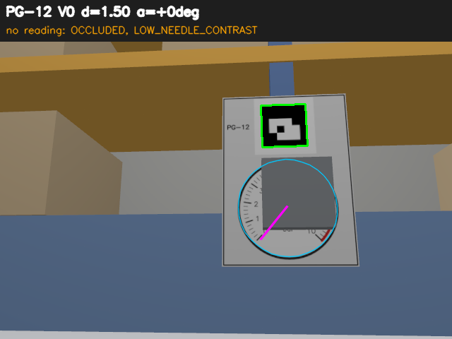
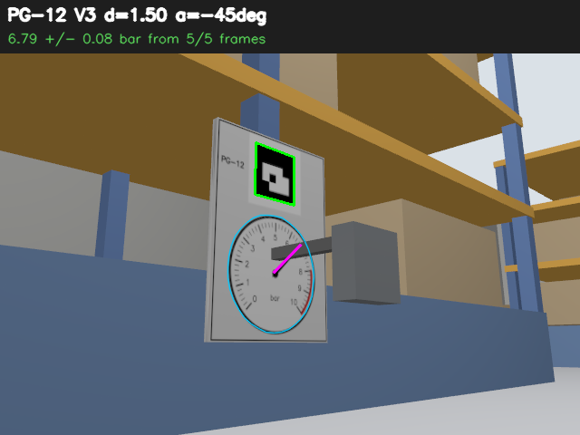
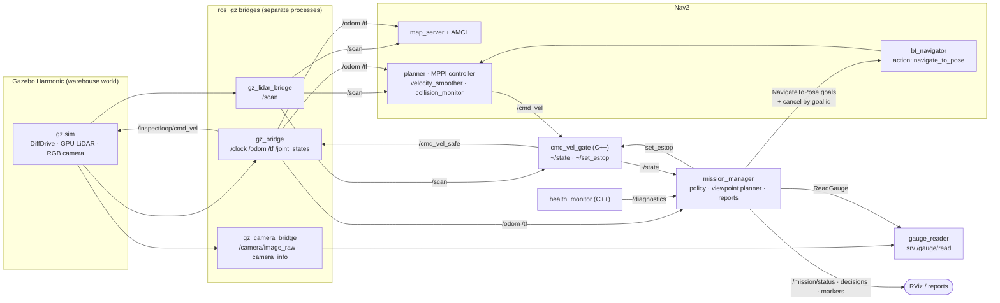

# InspectLoop — Uncertainty-Aware Autonomous Gauge Inspection (ROS 2 Jazzy · Nav2 · Gazebo Harmonic)

[](https://github.com/Tamer1020/InspectLoop/actions/workflows/ci.yml)
   

A simulated differential-drive robot patrols an industrial warehouse, **reads analog pressure
gauges with OpenCV, judges whether each reading can be trusted, and — when it cannot — decides
to look again, drive to a better viewpoint with Nav2, or report that no valid reading is
possible.** A C++ velocity gate between Nav2 and the robot stops motion when the LiDAR cannot
observe the direction of travel.

> **Scope.** Simulation-only portfolio project. Not production software, not tested on hardware,
> not a certified safety function, and the reported uncertainty (σ_h) is a heuristic, not a
> calibrated probability. See [Verification status](#verification-status) and
> [Known limitations](docs/KNOWN_LIMITATIONS.md).

## The engineering problem

A robot that reads instruments is only useful if it knows when *not* to trust itself. Gauges are
occluded by pipes and crates, seen at oblique angles, or partly out of frame; a naive reader still
returns a number. InspectLoop treats every observation as a measurement with evidence:

```
observe ──► value ± σ_h + quality flags ──► decision policy
   ▲                                          ├─ ACCEPT      → record value, check alarm limits
   │                                          ├─ RETRY_SAME  → transient problem: observe again
   └──────── Nav2 ◄── viewpoint planner ◄─────┼─ MOVE_NEW    → geometric problem: new pose
                                              └─ UNRESOLVED  → no reliable reading within budget
```

Around that loop sit the parts a mobile robot needs to fail safely: fresh-frame and settled-robot
checks before reading, verified Nav2 goal cancellation on errors and Ctrl-C, and a last-line
velocity gate that fails closed on missing, malformed or blind LiDAR data.

## Demo

| Frontal view: dial hidden by a hanging conduit box → **MOVE_NEW** | Robot drives to −45° → reading accepted (6.79 bar, truth 6.80; earlier v1 run) |
|---|---|
|  |  |


### Demo video

<!-- DEMO-VIDEO-PLACEHOLDER: replace this block with the final demo video
     (e.g. a GitHub-hosted .mp4 dragged into the README editor, or a linked thumbnail:
     [](https://youtu.be/<id>) ). -->
> 🎬 **Demo video — coming soon.** A 60–90 s recording of a full GUI mission (Gazebo + RViz) will
> be placed here. No video has been recorded yet; the images above are real simulation
> screenshots from the development runs.

An RViz screenshot will be added with the video (RViz rendering was not captured on the
development machine).

### Result of the release-candidate run (headless, `docs/evidence/astra_v3_2/demo/`)

| Gauge | Situation | Decisions | Reported | Truth |
|---|---|---|---|---|
| PG-11 | clear | ACCEPT | 4.212 bar | 4.20 |
| PG-12 | conduit box in front of the dial (invisible to the 2-D LiDAR) | RETRY_SAME → MOVE_NEW → ACCEPT at −45° | 6.797 bar | 6.80 |
| PG-13 | crate stack in front of the gauge | RETRY_SAME / MOVE_NEW over 3 viewpoints → **UNRESOLVED** | no value | 3.10 |
| PG-14 | above alarm limit | ACCEPT, **alarm HIGH** | 8.699 bar | 8.70 |

Mission `COMPLETED`, launch exit 0, max |error| of accepted readings 0.012 bar, 0 incorrect
acceptances (`ros2 run inspectloop_mission evaluate_run <run>` against simulator ground truth).
This is one run in one world; earlier runs are in `docs/evidence/demo_run_v3*`.

## Capabilities

* **Perception** — ArUco-anchored homography, dial rectification, bezel-ellipse refinement and a
  needle-evidence test on 16 rings; 5-frame bursts → median value, heuristic σ_h, typed quality
  flags (`OCCLUDED`, `OBLIQUE_VIEW`, `TOO_FAR`, `AMBIGUOUS_NEEDLE`, `TAG_NOT_VISIBLE`,
  `FROZEN_FRAMES`, `STALE_OBSERVATION`, …).
* **Decision** — rule-based policy with an explicit measurement contract (finite value on the
  printed scale, σ_h ≤ 0.15 bar, ≥ 3 valid frames, no flag) and a viewpoint/observation budget.
* **Planning** — 15 candidate viewpoints per gauge (3 distances × 5 angles) filtered for
  footprint clearance on the occupancy map; directions found occluded are blocked.
* **Navigation** — Nav2 (AMCL, MPPI controller, behaviour tree) driven through an action client
  that tracks every goal to a confirmed terminal state; goal IDs are chosen before sending so even
  a goal whose handle was lost can be cancelled by ID (never a cancel-all on the shared server).
* **Safety layer (C++17)** — `cmd_vel_gate`: steady-clock watchdog, scan validation (metadata,
  REP-117 ranges, stamps, clock jumps), per-direction sector coverage (forward, reverse,
  rotation), obstacle corridors, deadman, latched e-stop service; bounded O(n) work per scan.
  `health_monitor`: stream rate/age and TF diagnostics.
* **Reporting** — JSON / Markdown / HTML mission reports with images, plus an offline evaluator.
* **Fault injection** — scripts that kill bridges, publish invalid sensor streams, reset sim time
  or SIGINT the mission while Nav2 executes a goal.

## Technical stack

ROS 2 Jazzy · Nav2 1.3 (AMCL, MPPI, bt_navigator) · Gazebo Harmonic (gz-sim 8) via `ros_gz` ·
C++17 (rclcpp, GoogleTest) · Python 3.12 (rclpy, OpenCV 4.6, NumPy, pytest) · xacro/URDF ·
colcon / ament · GitHub Actions CI (full build + `colcon test` in a `ros:jazzy-ros-base` container on every push).

## Architecture



Only `/cmd_vel_safe` (the gate's output) is bridged to the simulated base, so Nav2 cannot drive
the robot around the gate. Node graph, TF tree, QoS choices and design decisions:
[docs/ARCHITECTURE.md](docs/ARCHITECTURE.md).

| Package | Contents |
|---|---|
| `inspectloop_description` | Xacro diff-drive robot, computed inertias, 2-D GPU LiDAR, RGB camera, REP-103 frames |
| `inspectloop_gazebo` | Warehouse world, gauge panels, occluders and the Nav2 map generated from one layout file; bridges; supervised `gz sim` |
| `inspectloop_navigation` | AMCL + Nav2 (MPPI) parameters, map, RViz config |
| `inspectloop_safety` (C++17) | `cmd_vel_gate`, `health_monitor`, ROS-independent core library + GoogleTests |
| `inspectloop_vision` | Gauge reader library, reader worker process, ROS service node |
| `inspectloop_mission` | Mission manager, decision policy, viewpoint planner, Nav2 goal lifecycle, reports, evaluator |
| `inspectloop_interfaces` | `GaugeReading`, `GaugeDecision`, `MissionStatus`, `ReadGauge` |
| `inspectloop_bringup` | One launch file for the whole system |

## Setup (Ubuntu 24.04 + ROS 2 Jazzy)

Developed and verified on Ubuntu 24.04.5 (WSL2), ROS 2 Jazzy, Nav2 1.3.13, ros_gz 1.0.24
(Gazebo Harmonic, gz-sim 8.15), OpenCV 4.6.0, GCC 13.3, Python 3.12. Full notes:
[docs/SETUP.md](docs/SETUP.md).

```bash
# ROS 2 Jazzy installed per https://docs.ros.org/en/jazzy/Installation/Ubuntu-Install-Debs.html
sudo apt update
sudo apt install -y ros-jazzy-desktop ros-jazzy-navigation2 ros-jazzy-nav2-bringup \
  ros-jazzy-ros-gz ros-jazzy-xacro ros-jazzy-robot-state-publisher ros-jazzy-cv-bridge \
  python3-opencv python3-numpy python3-yaml python3-pytest python3-colcon-common-extensions

git clone https://github.com/Tamer1020/InspectLoop.git ~/InspectLoop
cd ~/InspectLoop
source /opt/ros/jazzy/setup.bash
rosdep install --from-paths src --ignore-src -y     # optional: resolves the rest from package.xml
colcon build --symlink-install
source install/setup.bash
```

## Run

```bash
# full demo with Gazebo GUI + RViz
ros2 launch inspectloop_bringup inspectloop.launch.py
# headless; exits when the mission ends (≈ 4 min wall time on the reference machine)
ros2 launch inspectloop_bringup inspectloop.launch.py headless:=true rviz:=false exit_on_mission_end:=true
# results: one folder per mission
ls ~/inspectloop_runs/
ros2 run inspectloop_mission evaluate_run ~/inspectloop_runs/<mission_id>
```

If a crash leaves simulator processes behind: `scripts/cleanup_sim.sh` (matches only InspectLoop
processes). More: [docs/RUN_DEMO.md](docs/RUN_DEMO.md) · [docs/TROUBLESHOOTING.md](docs/TROUBLESHOOTING.md).

## Verification

```bash
export ROS_DOMAIN_ID=87          # keep tests isolated from a running simulation
colcon test && colcon test-result --verbose
```

Last full run on the release candidate: **500 results, 0 errors, 0 failures, 0 skipped** —
489 test cases (C++ GoogleTest 68, vision pytest 208, mission pytest 187, gazebo / description /
navigation / bringup 26) plus 11 CTest wrapper entries — identical locally and in
[GitHub Actions CI](https://github.com/Tamer1020/InspectLoop/actions/workflows/ci.yml) (Release build). CI runs the unit and
component tests only; the Gazebo / Nav2 simulation is not run in CI.

Live integration and fault-injection scripts (each needs the simulation stack, run one at a time):

```bash
scripts/fault_test.sh lidar|camera|scan_nan|scan_empty|scan_front_nan|image_frozen|image_future|clock_reset <out_dir>
scripts/interrupt_test.sh <out_dir>                                   # SIGINT while Nav2 drives
docs/evidence/astra_v3_2/tools/tiny_inc_fault.sh <out_dir>            # malformed LaserScan metadata
docs/evidence/astra_v3_2/tools/sigint_at_dispatch.sh <out_dir> <n>    # SIGINT right after goal n is sent
docs/evidence/astra_v3_2/tools/live_unknown_goal.sh <out_dir>         # lost goal handle → cancel by goal id
```

### Verification status

Everything runs in simulation. The table separates what was checked, and how.

| Level | What | Evidence |
|---|---|---|
| **Unit / component tests** (automated, `colcon test`) | Gauge reader on synthetic images, decision policy, viewpoint planner, report generation, Nav2 goal lifecycle against fakes **and a real rclpy action server** (late acceptance, cancel refused, SIGINT at every bytecode of the send path, cancel by goal ID without touching other clients' goals), velocity-gate logic (scan validation, sector coverage, bounded work, watchdog scheduling), world/map generation, URDF, launch files | `src/*/test/`, [docs/TEST_RESULTS.md](docs/TEST_RESULTS.md) |
| **Offline evaluation** (synthetic, ground truth) | 400-burst frozen test set: 208 accepted, 0 incorrect acceptances | `docs/evidence/astra_v3/f1_eval/` |
| **Live integration** (Gazebo + Nav2 on the development machine, headless) | Full 4-gauge missions; LiDAR/camera loss; all-NaN, empty, front-blind and malformed-metadata scans (gate stops, timer keeps its 20 Hz period); frozen / future-stamped images; sim-time reset; SIGINT during navigation and right after goal dispatch (goal cancelled and confirmed in Nav2's status); lost goal handle cancelled by goal ID (control run without the fix: robot kept driving) | `docs/evidence/demo_run_v3*`, `docs/evidence/astra_v3/faults/`, `docs/evidence/astra_v3_1_live/`, `docs/evidence/astra_v3_2/` |
| **Not verified** | Real hardware, real camera images, glare/blur; RViz rendering; gate e-stop service failure or gate restart during shutdown; long-duration or randomised runs; SLAM mapping | [docs/KNOWN_LIMITATIONS.md](docs/KNOWN_LIMITATIONS.md) |

Live results are developer-reported from one machine (logs, mission records and images are
archived under `docs/evidence/`). Folders named `astra*` belong to independent review rounds;
each fix there was first reproduced with a failing test (`before_fix_*.txt`).

## Navigation, perception, quality assessment and decisions

* **Navigation** — AMCL localises on a map generated from the same layout file as the world;
  `bt_navigator` + MPPI drive to each viewpoint. The mission's goal runner tracks every
  `NavigateToPose` goal to a confirmed terminal state; rejected / aborted / timed-out goals are
  retried, then the viewpoint is treated as unreachable and the next candidate is used.
* **Perception** — once fresh odometry shows the robot at rest, a burst of 5 frames stamped
  after the request (never future-dated, captured at the requested viewpoint per TF) is read
  independently: ArUco pose → homography → rectified dial → bezel-ellipse refinement → needle
  angle from a one-lobe evidence test on 16 rings. Reading runs in a separate worker process.
* **Quality assessment** — value = median of valid frames; heuristic
  σ_h² = (1.25·spread/√n)² + σ_res² + 0.03²; typed flags explain *why* an observation is
  weak (geometry: `OCCLUDED`, `OBLIQUE_VIEW`, `TOO_FAR`; evidence: `AMBIGUOUS_NEEDLE`,
  `LOW_NEEDLE_CONTRAST`; data validity: `FROZEN_FRAMES`, `INVALID_FRAMES`, `STALE_OBSERVATION`,
  `CLOCK_RESET`, …), and every gauge result gets an `outcome_class` (measured / insufficient
  visual evidence / camera unavailable / image invalid / system fault / navigation failure).
* **Decisions** — ACCEPT only if the measurement contract holds (finite value inside the printed
  scale, σ_h ≤ 0.15 bar, ≥ 3 valid frames, no flag); transient problems → RETRY_SAME (once per
  pose); geometric problems → MOVE_NEW with a hint (`different_side` / `frontal` / `closer`);
  sensor faults or a spent budget (3 viewpoints / 8 observations) → UNRESOLVED. Occlusion is
  discovered by looking, not predicted from the 2-D map.

Details: [docs/ARCHITECTURE.md](docs/ARCHITECTURE.md).

## Safety architecture and fault handling

Three layers, each failing closed. This is a **simulated** guard, not a certified safety
function.

1. **`cmd_vel_gate` (C++17, last line).** Sits between Nav2's `/cmd_vel` and the only velocity
   topic bridged to the base. A 20 Hz steady-clock timer publishes zero velocity unless *all*
   hold: e-stop released; a scan arrived within 0.5 s with valid metadata, plausible stamp and no
   backward clock jump; the swept sector of each motion component (forward, reverse, rotation) is
   observed (≥ 95 % of directions, no unobserved wedge > 2°, resolution ≤ 1°); no obstacle in the
   corridor; a command arrived within 0.5 s. Work per scan is bounded (≤ 3·(n+6) beam lookups),
   so malformed metadata cannot starve the watchdog timer.
2. **`health_monitor`.** Stream rates / ages and TF freshness on `/diagnostics`.
3. **Mission.** Aborts on persistent gate faults or failed streams; every goal is cancelled and
   its terminal state confirmed (by goal ID if the handle was lost — never a cancel-all on the
   shared action server); if cancellation cannot be confirmed it latches the gate's e-stop.

| Fault (live, Gazebo + Nav2) | Observed handling | Evidence |
|---|---|---|
| LiDAR bridge killed / all-NaN scans while driving | gate `STOPPED_SCAN_FAULT` (scan timeout), robot stops, goal cancel confirmed, mission ABORTED | `docs/evidence/astra_v3/faults/{lidar,scan_nan}/` |
| Empty scans | `STOPPED_SCAN_FAULT (scan EMPTY)`, ABORTED | `…/faults/scan_empty/` |
| ±35° front sector NaN, rest valid | `BLOCKED_UNOBSERVED` (forward coverage 0.42), ABORTED | `…/faults/scan_front_nan/` |
| 720 beams with `angle_increment` 1e-9 | `STOPPED_SCAN_FAULT (scan BAD_METADATA)`, robot 0.40 → 0 m/s, gate output kept its 50 ms period | `docs/evidence/astra_v3_1_live/f3_tiny_inc/` |
| Camera bridge killed | `NO_IMAGE` → UNRESOLVED ("moving cannot fix a sensor fault") | `…/faults/camera/` |
| Frozen / future-stamped frames | `FROZEN_FRAMES` / `INVALID_FRAMES` → UNRESOLVED, never used as evidence | `…/faults/image_{frozen,future}/` |
| Simulation time reset | gate stops (clock jumped backwards), observation invalidated (`CLOCK_RESET`), no value accepted | `…/faults/clock_reset/` |
| SIGINT while driving / right after goal dispatch | goal cancelled and confirmed CANCELED in Nav2's status, robot 0 m/s | `…/faults/sigint_interrupt/`, `docs/evidence/astra_v3_2/sigint_dispatch_*/` |
| Goal handle lost (injected) | cancelled by goal ID, confirmed; control run without the fix kept driving | `docs/evidence/astra_v3_2/live_unknown_goal/` |

**Not tested:** e-stop service failure or gate restart during shutdown (the latch is in memory and
a restarted gate releases it), a goal request lost before reaching Nav2 (unit-tested: stays
motion-inhibited), anything on hardware.

## Known limitations

Full list with measured facts and open risks: [docs/KNOWN_LIMITATIONS.md](docs/KNOWN_LIMITATIONS.md). The main ones:

* The dial is located with a printed fiducial; imagery is rendered (no glare, blur or lens
  distortion); thresholds are hand-set; σ_h was checked, not statistically validated, against
  synthetic ground truth.
* The safety gate is a simulated guard: 2-D scan plane only (objects above or below it are
  invisible), hand-set coverage thresholds, in-memory e-stop latch that a gate restart clears.
* A Nav2 goal request that never reaches the server cannot be told apart from one still in
  flight: the mission stays motion-inhibited (fail closed) instead of continuing; after the
  mission process exits nothing watches for such a goal.
* Nav2's composed container may abort during launch shutdown (after the report is written).

## Future engineering work

* Real-camera dataset and a statistically calibrated uncertainty model; dial detection without
  fiducials.
* Persistent / hardware e-stop interlock and a goal-watchdog that outlives the mission process.
* 3-D obstacle sensing (depth camera or 3-D LiDAR) for the gate; stopping-distance-derived
  coverage thresholds.
* A headless simulation smoke test in CI; `ros2_control` instead of Gazebo's DiffDrive; SLAM.
* Long-duration and randomised-world testing.

## Documentation

[SETUP](docs/SETUP.md) · [RUN_DEMO](docs/RUN_DEMO.md) · [ARCHITECTURE](docs/ARCHITECTURE.md) ·
[TEST_RESULTS](docs/TEST_RESULTS.md) · [KNOWN_LIMITATIONS](docs/KNOWN_LIMITATIONS.md) ·
[TROUBLESHOOTING](docs/TROUBLESHOOTING.md) · review reports:
[V2](docs/ASTRA_FIX_REPORT.md), [V3](docs/ASTRA_V3_REMEDIATION_REPORT.md)

## License

Apache-2.0 — see [LICENSE](LICENSE).
