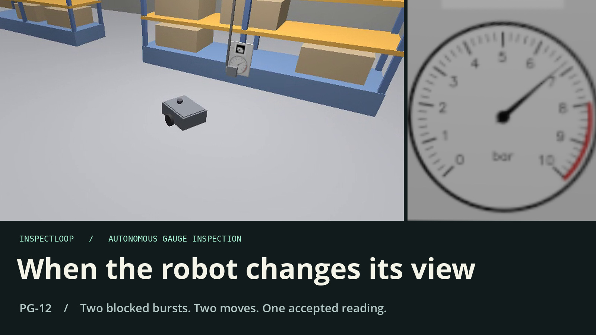
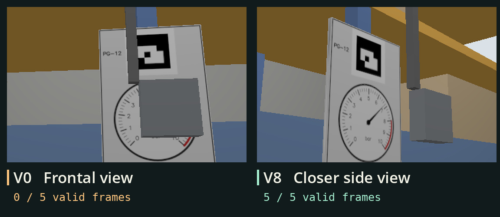
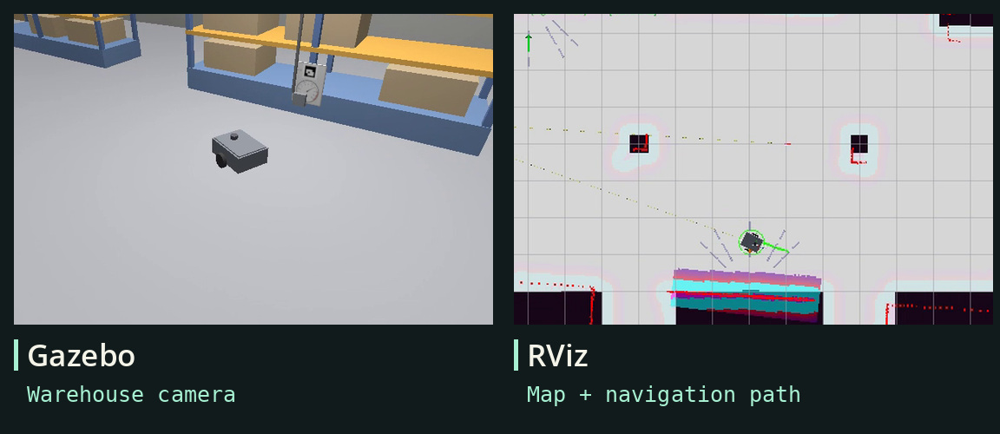
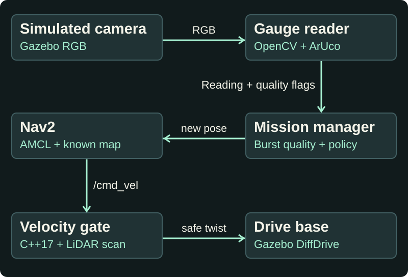
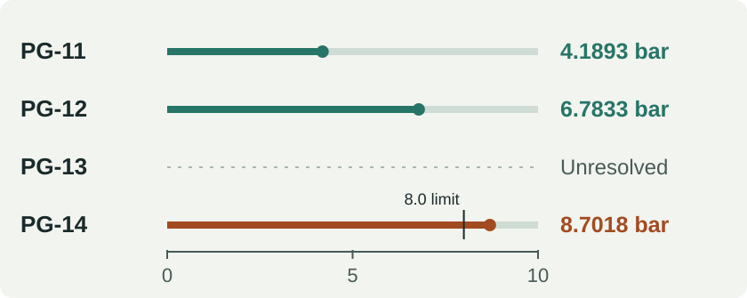

# InspectLoop

An autonomous mobile robot reads analog pressure gauges in a simulated warehouse. When an overhead conduit obscures a gauge marker, the robot chooses a new Nav2 goal, inspects the gauge again and decides whether the evidence supports a reading.

**[Watch the mission · 1 min 37 s](https://github.com/Tamer1020/InspectLoop/releases/download/v3.2.0/InspectLoop-Demo-V2.mp4)**　·　**[Watch PG-12 reinspection · 34 s](https://github.com/Tamer1020/InspectLoop/releases/download/v3.2.0/InspectLoop-PG12-V2.mp4)**

[](https://github.com/Tamer1020/InspectLoop/releases/download/v3.2.0/InspectLoop-Demo-V2.mp4)

ROS 2 Jazzy · Gazebo Harmonic · Nav2 / AMCL · OpenCV · Python · C++17

[Run the demo](docs/RUN_DEMO.md) · [Architecture and interfaces](docs/ARCHITECTURE.md) · [Mission report](docs/media/capture/20261115_140724_e358/mission_report.md) · [Release v3.2.0](https://github.com/Tamer1020/InspectLoop/releases/tag/v3.2.0)

## PG-12 · Why the robot moves twice



1. **V0 · Marker hidden.** A hanging conduit blocked the expected ArUco tag. Two five-frame bursts yielded zero valid frames. The first triggered `RETRY_SAME`, the second `MOVE_NEW`.
2. **V3 · A number, still too far.** Nav2 reached the −45° side view in 10.2 s of simulation time. Four frames yielded **6.8056 bar**, but the `TOO_FAR` flag blocked acceptance. The robot requested a closer goal at the same angle.
3. **V8 · Reading accepted.** At a target standoff of 1.20 m, all five frames were valid. The robot accepted their median, **6.7833 bar**. The offline reference was 6.8000 bar.



*Both views are from 02:02 in their source recordings. The main film shows the complete first reposition from 00:31.5 to 00:53.* [PG-12 film](https://github.com/Tamer1020/InspectLoop/releases/download/v3.2.0/InspectLoop-PG12-V2.mp4) · [Per-view evidence](docs/media/capture/20261115_140724_e358/gauge_PG-12.json) · [Source recordings and timing](tools/portfolio/v2/README.md)

## How the ROS 2 loop works



**Read and decide.** OpenCV uses the marker corners to rectify the dial and checks needle evidence across 16 rings. The mission manager checks timestamps and viewpoint identity. Acceptance requires at least three valid frames out of five, heuristic uncertainty at or below 0.15 bar and no blocking flags. [Gauge reader](src/inspectloop_vision/inspectloop_vision/gauge_reader.py) · [Decision policy](src/inspectloop_mission/inspectloop_mission/decision_policy.py)

**Navigate and guard motion.** AMCL localizes on a known occupancy map. The mission filters candidates for footprint clearance, then tests reachability by sending a Nav2 goal. A separate C++ gate checks LiDAR coverage, scan freshness, command age and obstacle clearance. Only its output, `/cmd_vel_safe`, reaches the base. [ROS 2 interfaces and TF](docs/ARCHITECTURE.md) · [C++ safety package](src/inspectloop_safety)

## One inspection round

The robot visited **8 viewpoints**, made **12 observations** and returned home. Three of four gauges produced accepted readings. The largest absolute error among those three was **0.0167 bar**, measured against simulator references after the run.



**PG-13** remained occluded through six observations at three viewpoints. The mission reported `UNRESOLVED` and left the pressure empty. **PG-14** produced a valid **8.7018 bar** reading, above its **8.0 bar** alarm limit. [Filmed mission report](docs/media/capture/20261115_140724_e358/mission_report.md) · [Machine-readable record](docs/media/capture/20261115_140724_e358/mission_record.json) · [Offline evaluation](docs/media/capture/20261115_140724_e358/evaluation.json)

## Verification and scope

- **Test suite.** The archived v3.2 report records 489 test cases plus 11 CTest wrapper entries, with zero failures. GitHub Actions builds the ROS 2 workspace and runs unit and component tests. [Archived output](docs/evidence/astra_v3_2/colcon_test_result.txt) · [Test coverage](docs/TEST_RESULTS.md) · [CI runs](https://github.com/Tamer1020/InspectLoop/actions/workflows/ci.yml)
- **Faults during motion.** In a separate simulation run, the gate rejected malformed LiDAR metadata. Measured linear speed fell from 0.40 m/s to zero. An independent interruption test recorded cancellation of the runner’s dispatched Nav2 goal. [Odometry trace](docs/evidence/astra_v3_1_live/f3_tiny_inc/odom_speed.txt) · [Goal lifecycle log](docs/evidence/astra_v3_2/live_unknown_goal/fallback.txt)
- **Operating limits.** The reader assumes a known panel, a fiducial and one 0–10 bar dial design. On the frozen synthetic evaluation it accepted 189/204 clean in-range cases and 19/158 difficult ones. Uncertainty is heuristic. The 2-D LiDAR has limited coverage and this release has simulation-only validation. [Known limitations](docs/KNOWN_LIMITATIONS.md)

<details>
<summary><strong>Reproduce the mission</strong></summary>

Use Ubuntu 24.04, ROS 2 Jazzy and Gazebo Harmonic. Install the [prerequisites](docs/SETUP.md), then run:

```bash
git clone https://github.com/Tamer1020/InspectLoop.git
cd InspectLoop
source /opt/ros/jazzy/setup.bash
rosdep install --from-paths src --ignore-src -y
colcon build --symlink-install
source install/setup.bash
ros2 launch inspectloop_bringup inspectloop.launch.py
```

For a headless run, add `headless:=true rviz:=false exit_on_mission_end:=true`. The mission writes `mission_report.html` under `~/inspectloop_runs/`. [Demo guide](docs/RUN_DEMO.md) · [Troubleshooting](docs/TROUBLESHOOTING.md)

</details>

<details>
<summary><strong>Other runs, original captures and planned comparisons</strong></summary>

In the earlier release-candidate run, PG-12 was accepted at the first alternate viewpoint at 6.7966 bar. In the filmed round, the first side view triggered a second move. [Earlier mission](docs/evidence/astra_v3_2/demo/20261115_130552_5c37/mission_record.json) · [Filmed mission](docs/media/capture/20261115_140724_e358/mission_record.json)

[Full Gazebo frame](docs/media/capture/gazebo-hero.png) · [Full RViz frame](docs/media/capture/rviz-navigation.png) · [V2 edit and source provenance](tools/portfolio/v2/README.md) · [Original capture notes](tools/portfolio/README.md)

Planned comparisons include matched fixed-view, repeated-view and active policies, and a six-landmark pose model evaluated against the classical reader. Further goals include held-out panel evaluation, ONNX Runtime latency measurements, a C++ mission executive and real-camera validation.

</details>

[Apache-2.0 license](LICENSE)
