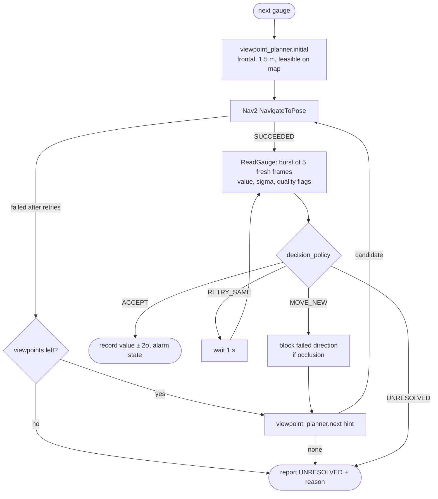
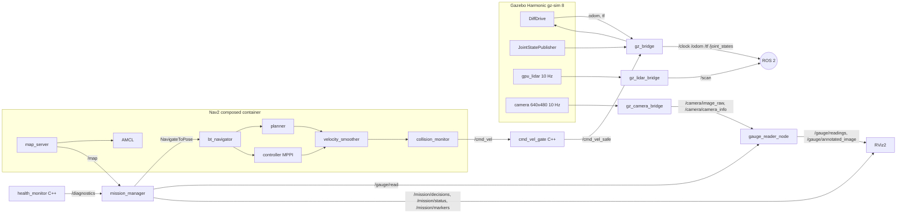

# InspectLoop — Architecture

InspectLoop is an **uncertainty-aware autonomous gauge inspection robot**. A differential-drive
AMR navigates a simulated warehouse with Nav2, reads analog pressure gauges with OpenCV, estimates
how much each reading can be trusted, and — when an observation is unreliable — decides on its
own whether to look again, drive to a better viewpoint, or report that no valid reading is possible.

## 1. Packages

| Package | Lang | Responsibility |
|---|---|---|
| `inspectloop_interfaces` | IDL | `GaugeReading.msg`, `GaugeDecision.msg`, `MissionStatus.msg`, `ReadGauge.srv` |
| `inspectloop_description` | Xacro | Robot URDF: diff-drive base, casters, 2D LiDAR, RGB camera, inertias, Gazebo plugins |
| `inspectloop_gazebo` | Python/SDF | Warehouse world, gauge panels, occluders, `ros_gz_bridge` configs, supervised sim launch, **world/map/texture generator** |
| `inspectloop_navigation` | YAML | Occupancy map, AMCL + Nav2 parameters, navigation launch, RViz config |
| `inspectloop_safety` | **C++17** | `cmd_vel_gate` (last-line velocity safety filter) and `health_monitor` (stream/TF diagnostics) |
| `inspectloop_vision` | Python + OpenCV | `gauge_reader` library (needle reading + uncertainty + quality flags) and `gauge_reader_node` service |
| `inspectloop_mission` | Python | `decision_policy`, `viewpoint_planner`, `mission_manager` (Nav2 action client), report generator, ground-truth evaluator |
| `inspectloop_bringup` | launch | One launch file for the whole system |

## 2. The inspection loop



### 2.1 Decision policy (`inspectloop_mission/decision_policy.py`)

| Decision | When | Rationale |
|---|---|---|
| **ACCEPT** | value present, ≥ 3/5 valid frames, no blocking flag, σ ≤ 0.15 bar | reading is reliable |
| **RETRY_SAME** | *transient-looking* problem: `NO_IMAGE`, `TAG_NOT_VISIBLE`, `TAG_INTERMITTENT`, `INCONSISTENT_FRAMES`, `BLURRED`, too few valid frames, or σ dominated by frame spread — at most 1 retry per viewpoint | a passer-by, a dropped frame or vibration goes away by itself; re-observing is cheaper than driving |
| **MOVE_NEW** | *geometric* problem: `OCCLUDED`, `OBLIQUE_VIEW`, `TOO_FAR`, `LOW_NEEDLE_CONTRAST`, `OUT_OF_SCALE`, or σ too high from resolution; also a transient problem that persisted after the retry, or an unreachable viewpoint | the view itself is bad, so a different pose is needed |
| **UNRESOLVED** | geometric/persistent problem with no viewpoint or observation budget left (≤ 3 viewpoints, ≤ 8 observations per gauge), or a camera fault (`NO_IMAGE` persists — moving cannot fix a sensor) | report honestly instead of guessing |

The policy returns a **hint** for the planner: `different_side` (occlusion, hidden tag, poor contrast),
`frontal` (too oblique), `closer` (too few pixels).

### 2.2 Viewpoint planner (`inspectloop_mission/viewpoint_planner.py`)

* Candidates: standoff d ∈ {1.5, 1.2, 1.9} m × view angle ∈ {0, ±30, ±45}° from the dial normal, each
  facing the dial.
* **Feasibility** on the `/map` occupancy grid: the robot disc (0.45 m = radius 0.33 + margin) must be in
  known free space. (At PG-13 the crate removes 7 of 15 candidates.)
* **Visibility is not predicted** from the 2-D map (no heights; the overhanging conduit box is invisible
  to the 2-D LiDAR). It is discovered by observing — that is the point of the closed loop.
* Selection: prior (frontal, 1.5 m) + hint bonus. After an occlusion-type failure the whole angular
  sector (±20°) of the failed view is blocked at every distance, so "move closer" can never send the
  robot back along a blocked line of sight; `closer` keeps the angle of the view that worked.

## 3. Computer vision and uncertainty (`inspectloop_vision/gauge_reader.py`)

Each gauge panel (generated texture) has an ArUco `DICT_4X4_50` tag (gauge id, with a one-cell quiet
zone) above a 0–10 bar dial (270° sweep, red zone 8–10 bar).

Per frame:
1. Detect the tag; homography **H** panel-texture → image from its 4 corners.
2. Rectify the image into the canonical panel frame (+ validity mask for pixels outside the image).
3. **Dial refinement**: fit an ellipse to the outer edge of the dark bezel (rays searched inward from
   1.06 R, top ±35° skipped next to the tag). This removes the bias caused by extrapolating H from a
   small tag to the dial (measured: up to 0.6 bar before, ≤ 0.05 bar after; see TEST_RESULTS).
4. **Needle**: darkness profile of rays 0.15–0.52 R around the refined centre, 0.5° steps; peak with
   parabolic sub-step refinement → angle → value.
5. **Evidence**: needle confidence (peak prominence, penalised by competing peaks > 12° away), dial
   visibility (fraction of the face annulus that is bright, unsaturated and in-image), view angle and
   distance (solvePnP with the real `camera_info`), apparent dial radius (mean and minor axis),
   Laplacian sharpness.

Per observation (burst of 5 frames stamped **after** the request + 0.5 s settle):

```
value  = median(valid frame readings)
sigma² = (1.25·spread/√n)² + σ_res² + σ_floor²
         spread  = 1.4826·MAD of frame readings                   (random error)
         σ_res   = 0.5 px needle localisation at 0.35 R along the
                   foreshortened (minor) dial axis, in bar           (resolution / obliqueness)
         σ_floor = 0.03 bar                                        (calibration floor)
```

Quality flags: `NO_IMAGE, TAG_NOT_VISIBLE, TAG_INTERMITTENT, OCCLUDED (visibility < 0.85),
OBLIQUE_VIEW (> 55°), TOO_FAR (minor radius < 28 px), LOW_NEEDLE_CONTRAST (< 0.35),
INCONSISTENT_FRAMES (spread > 0.2 bar), BLURRED, OUT_OF_SCALE`.

The σ model is a documented heuristic; it is checked against ground truth in unit tests (synthetic
views) and in the simulation runs (TEST_RESULTS.md). It is **conservative** on the tested conditions.

## 4. Node graph



LiDAR and camera each have their own bridge process so a sensor outage can be injected without
stopping `/clock` (used by `scripts/fault_test.sh`).

## 5. TF tree

```
map ──(AMCL)──► odom ──(Gazebo DiffDrive wheel odometry, bridged)──► base_footprint
                                                                       └─(fixed, z=0.08)─► base_link
                                                                            ├─ left/right_wheel_link (joint_states → robot_state_publisher)
                                                                            ├─ front/rear_caster_link
                                                                            ├─ lidar_link   (x=0.10, z=0.165 → scan plane 0.245 m above floor)
                                                                            └─ camera_link  (x=0.255, z=0.10, pitched 0.25 rad up)
                                                                                └─ camera_optical_link (REP-103 optical)
```

Sensor headers carry URDF frame names (`<gz_frame_id>`). The simulation world frame equals `map`
(the map is generated from the world). All nodes use `use_sim_time`.

## 6. Topics, types, QoS

| Topic | Type | QoS / notes |
|---|---|---|
| `/scan` | sensor_msgs/LaserScan | SENSOR_DATA (best effort) |
| `/camera/image_raw`, `/camera/camera_info` | Image / CameraInfo | reliable pub; reader subscribes best-effort |
| `/odom`, `/tf`, `/joint_states`, `/clock` | | from `gz_bridge` |
| `/cmd_vel` → `/cmd_vel_safe` | geometry_msgs/Twist | collision_monitor → gate → DiffDrive |
| `/map`, `/amcl_pose` | | **transient local** (mission subscribes latched) |
| `/diagnostics` | DiagnosticArray | health_monitor, 1 Hz |
| `/gauge/read` | srv ReadGauge | mission → gauge_reader_node |
| `/gauge/readings` | GaugeReading | every observation |
| `/mission/decisions` | GaugeDecision | every decision (ACCEPT/RETRY_SAME/MOVE_NEW/UNRESOLVED) |
| `/mission/status` | MissionStatus | 2 Hz |
| `/mission/markers` | MarkerArray | transient local: candidates, visited viewpoints coloured by decision, results |

## 7. Safety layer (C++)

`cmd_vel_gate` (20 Hz) priority: e-stop (`~/set_estop`) > LiDAR stale 0.5 s > command stale 0.5 s /
non-finite > obstacle < 0.20 m ahead of the bumper in the robot-width corridor (forward blocked,
rotation allowed; slow-down to 0.45 m) > clamp |v| ≤ 0.45 m/s, |ω| ≤ 1.3 rad/s.
`health_monitor` checks rate/age of `/scan`, `/odom`, `/camera/*`, `/joint_states` (type-agnostic
`GenericSubscription`) and TF links, publishing `/diagnostics`. The mission aborts on LiDAR ERROR.

## 8. World and map

`inspectloop_gazebo/config/warehouse_layout.yaml` is the single source of truth (24 × 16 m warehouse,
6 racks, 3 pillars, 5 pallets, 4 gauges, 2 occluders). `generate_warehouse.py` renders the SDF world,
the gauge textures (needle at the ground-truth value) and the Nav2 map. Objects whose bottom is above
the LiDAR scan plane (0.245 m) are left out of the map — they are invisible to the 2-D LiDAR in the
simulation too. A unit test fails if the committed world/map/textures drift from the layout.

| Gauge | Truth | Situation |
|---|---|---|
| PG-11 | 4.2 bar | clear view |
| PG-12 | 6.8 bar | conduit box hangs 0.30 m in front of the dial (above the LiDAR plane): dial hidden from the front, visible from ±45° |
| PG-13 | 3.1 bar | 1.0 m crate stack 0.25 m in front: not visible from any reachable viewpoint |
| PG-14 | 8.7 bar | clear, above the 8.0 bar alarm limit |

## 9. Engineering decisions

| Decision | Reason |
|---|---|
| Fiducial tag + homography + bezel ellipse refinement | Gives a metric, perspective-correct dial frame; the bezel fit removes the extrapolation bias (measured). |
| Burst of fresh frames per observation | Causal link navigation → measurement; frame spread measures random error. |
| Explicit σ + flags, decisions in a separate pure policy | Testable, explainable decisions; each one is logged with its reason. |
| Visibility learned by observing, feasibility from the map | The 2-D map cannot predict occlusion by overhanging objects; the closed loop can. |
| Block failed directions | Prevents re-trying an occluded line of sight at another distance (bug found in sim run g1). |
| Gazebo `DiffDrive` instead of `gz_ros2_control` | `gz_ros2_control` is not installed here; DiffDrive gives wheel-integrated odometry + TF. |
| Supervised `gz sim` wrapper | The gz-tools ruby wrapper orphaned the server on shutdown (observed); the wrapper kills the process group. |
| Generated map | Exact and reproducible; avoids SLAM artefacts in a portfolio demo. |
