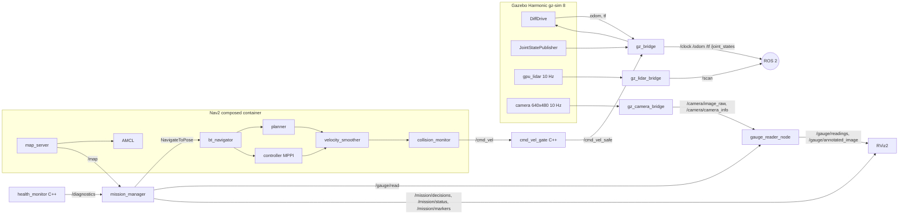

# InspectLoop — Architecture

InspectLoop is an **uncertainty-aware autonomous gauge inspection robot**. A differential-drive
AMR navigates a simulated warehouse with Nav2, reads analog pressure gauges with OpenCV, estimates
how much each reading can be trusted, and — when an observation is unreliable — decides on its
own whether to look again, drive to a better viewpoint, or report that no valid reading is possible.

## 1. Packages

| Package | Lang | Responsibility |
|---|---|---|
| `inspectloop_interfaces` | IDL | `GaugeReading.msg`, `GaugeDecision.msg`, `MissionStatus.msg`, `ReadGauge.srv` |
| `inspectloop_description` | Xacro | Robot URDF: diff-drive base, casters, 2D LiDAR, RGB camera, inertias, Gazebo plugins |
| `inspectloop_gazebo` | Python/SDF | Warehouse world, gauge panels, occluders, `ros_gz_bridge` configs, supervised sim launch, **world/map/texture generator** |
| `inspectloop_navigation` | YAML | Occupancy map, AMCL + Nav2 parameters, navigation launch, RViz config |
| `inspectloop_safety` | **C++17** | `cmd_vel_gate` (last-line velocity safety filter) and `health_monitor` (stream/TF diagnostics) |
| `inspectloop_vision` | Python + OpenCV | `gauge_reader` library (needle reading + uncertainty + quality flags) and `gauge_reader_node` service |
| `inspectloop_mission` | Python | `decision_policy`, `viewpoint_planner`, `mission_manager` (Nav2 action client), report generator, ground-truth evaluator |
| `inspectloop_bringup` | launch | One launch file for the whole system |

## 2. The inspection loop


### 2.1 Decision policy (`inspectloop_mission/decision_policy.py`)

| Decision | When | Rationale |
|---|---|---|
| **ACCEPT** | measurement contract holds (finite value inside the printed scale ±0.05 bar, finite σ_h > 0 and ≤ 0.15 bar, integer ≥ 3/5 valid frames, flag list well-formed) and no blocking flag | reading is supported by adequate evidence |
| **RETRY_SAME** | *transient-looking* problem: `NO_IMAGE`, `TAG_NOT_VISIBLE`, `TAG_INTERMITTENT`, `INCONSISTENT_FRAMES`, `BLURRED`, too few valid frames, or σ dominated by frame spread — at most 1 retry per viewpoint | a passer-by, a dropped frame or vibration goes away by itself; re-observing is cheaper than driving |
| **MOVE_NEW** | *geometric* problem: `OCCLUDED`, `OBLIQUE_VIEW`, `TOO_FAR`, `LOW_NEEDLE_CONTRAST`, `AMBIGUOUS_NEEDLE`, `NEEDLE_PARTIAL`, `OUT_OF_SCALE`, or σ too high from resolution; also a transient problem that persisted after the retry, or an unreachable viewpoint | the view itself is bad, so a different pose is needed |
| **UNRESOLVED** | geometric/persistent problem with no viewpoint or observation budget left (≤ 3 viewpoints, ≤ 8 observations per gauge), or a fault moving cannot fix (`NO_IMAGE`, `FROZEN_FRAMES`, `CLOCK_RESET`, malformed measurement) that persists after a retry | report honestly instead of guessing |

The policy returns a **hint** for the planner: `different_side` (occlusion, hidden tag, poor contrast),
`frontal` (too oblique), `closer` (too few pixels).

### 2.2 Viewpoint planner (`inspectloop_mission/viewpoint_planner.py`)

* Candidates: standoff d ∈ {1.5, 1.2, 1.9} m × view angle ∈ {0, ±30, ±45}° from the dial normal, each
  facing the dial.
* **Feasibility** on the `/map` occupancy grid: the robot disc (0.45 m = radius 0.33 + margin) must be in
  known free space. (At PG-13 the crate removes 7 of 15 candidates.) *Feasible means footprint-clear
  only* (V3, Astra F8): no Nav2 path is planned beforehand, so a feasible candidate can still be
  unreachable. That is discovered by navigating: a failed goal is recorded as `NAV_FAILED`, the
  mission moves on (MOVE_NEW) or ends with outcome class `NAVIGATION_FAILURE`.
* **Visibility is not predicted** from the 2-D map (no heights; the overhanging conduit box is invisible
  to the 2-D LiDAR). It is discovered by observing — that is the point of the closed loop.
* Selection: prior (frontal, 1.5 m) + hint bonus. After an occlusion-type failure the whole angular
  sector (±20°) of the failed view is blocked at every distance, so "move closer" can never send the
  robot back along a blocked line of sight; `closer` keeps the angle of the view that worked.

## 3. Computer vision and uncertainty (`inspectloop_vision/gauge_reader.py`)

Each gauge panel (generated texture) has an ArUco `DICT_4X4_50` tag (gauge id, with a one-cell quiet
zone) above a 0–10 bar dial (270° sweep, red zone 8–10 bar).

Per frame:
1. Detect the tag; homography **H** panel-texture → image from its 4 corners.
2. Rectify the image into the canonical panel frame (+ validity mask for pixels outside the image).
3. **Dial refinement**: ellipse fit to the outer edge of the dark bezel (removes the bias of
   extrapolating H from a small tag to the dial).
4. **Needle evidence (Astra F1)** on 16 rings between 0.15 R and 0.52 R:
   * each ring must show the needle as one dark lobe; its darkness-weighted centroid gives the
     ring's angle; rings must agree (`needle_support` = consistent rings / usable rings, ≥ 0.70);
   * `needle_ambiguity` = strongest competing lobe / needle lobe (75th percentile over outer rings,
     limit 0.45);
   * **model residual**: a tapered, blurred needle model (known geometry) is fitted within ±20°
     of the estimate; dark structure it cannot explain (second line, shadow, cable) relative to
     the needle's own energy must stay ≤ 0.075;
   * the sweep extends 20° beyond the scale so an out-of-scale needle is *measured and flagged*,
     never clamped; a needle at the sweep edge is reported without a value.
5. **Evidence**: needle confidence, dial visibility (the needle's *geometric footprint* is
   excluded, not a fixed wedge), view angle/distance (solvePnP), dial radius (mean and minor axis;
   ≥ 40 px required — below that the needle-model test cannot exclude nearby lines), sharpness.

Per observation (burst of 5 frames, see §6.1 for freshness):

```
value   = median(valid, finite frame readings)
sigma_h = sqrt((1.25·spread/√n)² + σ_res² + σ_floor²)      HEURISTIC uncertainty indicator
```

σ_h is **not** a calibrated probability, and value ± k·σ_h is not a confidence interval (Astra F6).
It is used as a threshold quantity (σ_h ≤ 0.15 bar). Held-out error statistics are reported in
docs/ASTRA_FIX_REPORT.md.

Quality flags: `NO_IMAGE, TAG_NOT_VISIBLE, TAG_INTERMITTENT, OCCLUDED, OBLIQUE_VIEW, TOO_FAR,
LOW_NEEDLE_CONTRAST, AMBIGUOUS_NEEDLE, NEEDLE_PARTIAL, INCONSISTENT_FRAMES, BLURRED, OUT_OF_SCALE`
(reader), `FROZEN_FRAMES, CLOCK_RESET, WRONG_VIEWPOINT, ROBOT_MOVING` (reader node) and
`STALE_OBSERVATION` (mission re-validation).

## 4. Node graph



LiDAR and camera each have their own bridge process so a sensor outage can be injected without
stopping `/clock` (used by `scripts/fault_test.sh`).

## 5. TF tree

```
map ──(AMCL)──► odom ──(Gazebo DiffDrive wheel odometry, bridged)──► base_footprint
                                                                       └─(fixed, z=0.08)─► base_link
                                                                            ├─ left/right_wheel_link (joint_states → robot_state_publisher)
                                                                            ├─ front/rear_caster_link
                                                                            ├─ lidar_link   (x=0.10, z=0.165 → scan plane 0.245 m above floor)
                                                                            └─ camera_link  (x=0.255, z=0.10, pitched 0.25 rad up)
                                                                                └─ camera_optical_link (REP-103 optical)
```

Sensor headers carry URDF frame names (`<gz_frame_id>`). The simulation world frame equals `map`
(the map is generated from the world). All nodes use `use_sim_time`.

## 6. Topics, types, QoS

| Topic | Type | QoS / notes |
|---|---|---|
| `/scan` | sensor_msgs/LaserScan | SENSOR_DATA (best effort) |
| `/camera/image_raw`, `/camera/camera_info` | Image / CameraInfo | reliable pub; reader subscribes best-effort |
| `/odom`, `/tf`, `/joint_states`, `/clock` | | from `gz_bridge` |
| `/cmd_vel` → `/cmd_vel_safe` | geometry_msgs/Twist | collision_monitor → gate → DiffDrive |
| `/map`, `/amcl_pose` | | **transient local** (mission subscribes latched) |
| `/diagnostics` | DiagnosticArray | health_monitor, 1 Hz |
| `/gauge/read` | srv ReadGauge | mission → gauge_reader_node |
| `/gauge/readings` | GaugeReading | every observation |
| `/mission/decisions` | GaugeDecision | every decision (ACCEPT/RETRY_SAME/MOVE_NEW/UNRESOLVED) |
| `/mission/status` | MissionStatus | 2 Hz |
| `/mission/markers` | MarkerArray | transient local: candidates, visited viewpoints coloured by decision, results |

## 6.1 Observation freshness and provenance (Astra F5, extended in V3)

* The mission increments a **viewpoint epoch** before every new viewpoint; each request carries a
  unique `observation_id` (`<mission_id>/<gauge>/<viewpoint>/<n>`), the epoch and the viewpoint pose.
* Before requesting, the mission waits until `/odom` shows the robot at rest for 0.5 s — judged on
  the odometry **message stamps**, and only if the newest sample is ≤ 0.3 s old and the window
  holds ≥ 3 samples (V3: a stalled odometry stream can no longer "prove" rest).
* **Clock epochs (V3):** the mission and the reader register an rclpy clock-jump callback; *every*
  backward ROS-clock step (no size threshold, only 1 ms float tolerance in the frame buffer)
  increments the clock epoch / clears the frame buffer. A result whose request and consumption fall
  into different clock epochs is rejected, as is a burst during which the reader saw a jump.
* The reader node clears its buffer on a new epoch and on a backward clock jump, accepts only
  frames stamped in [request + 0.5 s, now + 0.2 s], flags pixel-identical bursts
  (`FROZEN_FRAMES`), and looks up the robot pose at each frame's stamp in TF
  (`WRONG_VIEWPOINT` > 0.35 m / 0.40 rad, `ROBOT_MOVING` > 2 cm / 0.02 rad during the burst).
* The mission re-validates every reply when it **consumes** it (`observation_guard.py`): matching
  id, mission and epoch, same clock epoch, request ≤ first frame ≤ last frame ≤ now + 0.2 s,
  result age (now − last frame) ≤ 8 s sim time (V3; measured ages in the demo 0.2–0.8 s), a known
  capture pose at the viewpoint, and no value without frames. Otherwise the observation becomes
  `STALE_OBSERVATION` without a value. The record keeps request, frame, consumption times, result
  age and both clock epochs.
* **Typed outcomes (V3, F7):** each reading carries `fault_class` (`NONE`, `CAMERA_UNAVAILABLE`,
  `IMAGE_INVALID`, `PROCESSING_ERROR`, mission-side `SERVICE_FAILURE`, `INSUFFICIENT_EVIDENCE`);
  a reader exception is `PROCESSING_ERROR` (V2 reported it as `NO_IMAGE`), frames that arrived but
  were all inadmissible are `INVALID_FRAMES`. Each gauge result has an `outcome_class`
  (`MEASURED`, `INSUFFICIENT_VISUAL_EVIDENCE`, `CAMERA_UNAVAILABLE`, `IMAGE_INVALID`,
  `SYSTEM_FAULT`, `NAVIGATION_FAILURE`). System/sensor faults retry once and then end UNRESOLVED;
  they never trigger MOVE_NEW.
* **Reader process (V3):** frames are read in a dedicated `spawn` worker process
  (`reader_worker.py`). Inside the node, GIL contention with rclpy callbacks (/clock at ~1 kHz,
  /tf, images) had stretched a 0.1 s burst to 8–12 s (found in the V3 demo, see
  `ASTRA_V3_REMEDIATION_REPORT.md`); the TF poses are now looked up before processing.

## 6.2 Nav2 goal lifecycle (Astra F4)

`nav_goal.NavGoalRunner` tracks every goal until a terminal result is observed.

* **Ownership before sending (V3.1).** The pending record is registered *before*
  `send_goal_async` is called and the send runs inside the exception-cleanup scope, so there is no
  instruction between "request sent" and "request owned" where an exception or SIGINT could orphan
  a goal (regression: SIGINT injected at every bytecode after the send returns).
* **Goal IDs chosen before sending (V3.2).** The runner passes its own `goal_uuid`. If the handle
  is lost anyway (`send_goal_async` raised, or SIGINT landed before its future was stored),
  ownership is *unknown* but the ID is known: cleanup cancels **only that ID** through
  `navigate_to_pose/_action/cancel_goal` and confirms it on `navigate_to_pose/_action/status`
  (`GoalIdCanceller`). The cancel-all form is refused: `bt_navigator` (its `/goal_pose` path),
  `waypoint_follower`, `docking_server` and RViz's Nav2 panel share the action server.
  An unknown goal is resolved only when the server reports that ID terminal **and** fresh
  odometry shows the robot stationary; `ERROR_UNKNOWN_GOAL_ID`, a refused or unanswered cancel,
  or an unobservable status leave it unresolved.
* **Confirmed cancellation.** Late acceptances are cancelled; a cancel is confirmed only by an
  `ERROR_NONE` / `ERROR_GOAL_TERMINATED` reply listing the goal **and** a terminal result.
* **Fail closed.** While anything is unresolved no new goal is sent; after a 30 s grace the
  mission latches the gate e-stop and aborts. Cleanup never raises (a second Ctrl-C included) and
  never reports success while anything is unresolved; at mission end a failed cleanup latches the
  e-stop. rclpy signal handling is disabled in the mission process so the executor can still
  talk to Nav2 during an interrupt.

Remaining risks (request lost in flight, nothing watching after the process exits, e-stop
latch lost on gate restart): [KNOWN_LIMITATIONS.md](KNOWN_LIMITATIONS.md).

## 7. Safety layer (C++) — a simulated safety/health guard, not a certified safety function

`cmd_vel_gate` runs its loop on a wall timer and judges liveness on the **steady clock**. The
decision logic lives in the ROS-independent `GateSupervisor` (unit tested exactly as it runs);
the node only forwards messages and clock readings.
Priority: e-stop (`~/set_estop`) > LiDAR fault > command stale 0.5 s / negative / non-finite age >
**per-direction coverage** > obstacle in the swept corridor > clamping.

**Bounded work per scan (V3.1).** Sector coverage looks up at most 3·(n + 6) beams for an n-beam
scan, independent of the sector size in sample directions (V3 iterated 2π / `angle_increment`
directions: a 720-beam scan claiming 1e-9 rad resolution blocked the single-threaded executor,
and with it the gate's watchdog timer, for minutes). Tested: identical results to the V3
algorithm on 4 800 plausible scan/sector combinations; scan callback ≪ 5 ms on adversarial input;
live, `/cmd_vel_safe` kept its 50 ms period while malformed scans arrived.

**Motion-sector coverage (V3, Astra F3).** Each motion component needs positive evidence that the
region it sweeps is observed. A beam observes its ray if it is finite in [range_min, range_max]
or ±inf (REP-117); NaN, out-of-range values and directions the scanner does not sample are
*unknown*, never free space. Sectors: forward corridor ±atan2(0.27, 0.15) = ±60.9° (forward
motion), rear corridor ±atan2(0.27, 0.35) = ±37.6° around 180° (reverse motion — Nav2's MPPI may
reverse at up to 0.2 m/s), the full circle (in-place rotation). A sector is observed if ≥ 95 % of
its sample directions are observed, the widest unobserved wedge is ≤ 2°, and the angular
resolution is ≤ 1°. An unobserved direction zeroes only that motion component
(`BLOCKED_UNOBSERVED`); an obstacle inside the 0.35 m turning radius blocks rotation; an obstacle
< 0.20 m behind the rear edge blocks reverse motion (all parameters in `safety.yaml`). The mission
aborts if `BLOCKED_UNOBSERVED` persists for 3 s.
A LiDAR fault is: no scan for 0.5 s (steady), a structurally invalid scan (empty, bad metadata -
non-finite values, `angle_increment` < 1e-5 rad or > 2π, a span of more than one revolution -,
size inconsistent with the angular span, < 50 % usable beams overall or in the forward half;
REP-117: +inf = clear, −inf = obstacle at the sensor, NaN = unusable), a header stamp that is zero,
> 0.2 s in the future or > 1 s old, or a backward ROS-clock jump since the last scan.
`TopicMonitor` reports `CLOCK_JUMP` (→ ERROR) when evaluated at a time before its last message.
The mission aborts when the gate stays in `STOPPED_SCAN_FAULT` for 2 s (scans may still arrive at
full rate while being unusable, which a rate-only monitor would miss).
`health_monitor` checks rate/age of `/scan`, `/odom`, `/camera/*`, `/joint_states` (type-agnostic
`GenericSubscription`) and TF links, publishing `/diagnostics`. The mission aborts on LiDAR ERROR.

## 8. World and map

`inspectloop_gazebo/config/warehouse_layout.yaml` is the single source of truth (24 × 16 m warehouse,
6 racks, 3 pillars, 5 pallets, 4 gauges, 2 occluders). `generate_warehouse.py` renders the SDF world,
the gauge textures (needle at the ground-truth value) and the Nav2 map. Objects whose bottom is above
the LiDAR scan plane (0.245 m) are left out of the map — they are invisible to the 2-D LiDAR in the
simulation too. A unit test fails if the committed world/map/textures drift from the layout.

| Gauge | Truth | Situation |
|---|---|---|
| PG-11 | 4.2 bar | clear view |
| PG-12 | 6.8 bar | conduit box hangs 0.30 m in front of the dial (above the LiDAR plane): dial hidden from the front, visible from ±45° |
| PG-13 | 3.1 bar | 1.0 m crate stack 0.25 m in front: not visible from any reachable viewpoint |
| PG-14 | 8.7 bar | clear, above the 8.0 bar alarm limit |

## 9. Engineering decisions

| Decision | Reason |
|---|---|
| Fiducial tag + homography + bezel ellipse refinement | Gives a metric, perspective-correct dial frame; the bezel fit removes the extrapolation bias (measured). |
| Burst of fresh frames per observation | Causal link navigation → measurement; frame spread measures random error. |
| Explicit σ + flags, decisions in a separate pure policy | Testable, explainable decisions; each one is logged with its reason. |
| Visibility learned by observing, feasibility from the map | The 2-D map cannot predict occlusion by overhanging objects; the closed loop can. |
| Block failed directions | Prevents re-trying an occluded line of sight at another distance (bug found in sim run g1). |
| Gazebo `DiffDrive` instead of `gz_ros2_control` | `gz_ros2_control` is not installed here; DiffDrive gives wheel-integrated odometry + TF. |
| Supervised `gz sim` wrapper | The gz-tools ruby wrapper orphaned the server on shutdown (observed); the wrapper kills the process group. |
| Generated map | Exact and reproducible; avoids SLAM artefacts in a portfolio demo. |
