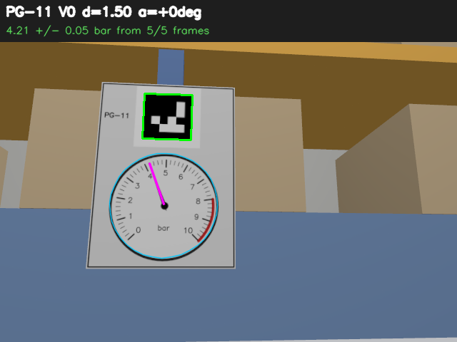

# InspectLoop Gauge Inspection Report — fault_injection_single_gauge

- **Mission ID:** `20261109_003523_0308`
- **Mission state:** **COMPLETED**
- **Started (wall clock):** 2026-11-09T00:35:23
- **Duration:** 11.0 s sim time / 42.4 s wall time
- **Data source:** Gazebo Harmonic simulation. Every value below was read by OpenCV from simulated camera frames captured after the robot reached the viewpoint; the robot does not know the true gauge values.
- **Uncertainty:** sigma is a HEURISTIC uncertainty model (frame spread + pixel resolution + floor). It is a diagnostic, not a calibrated probability: no confidence level or coverage is claimed for value +/- k*sigma.
- **Acceptance rule:** heuristic sigma ≤ 0.15 , ≥ 3 valid frames of 5, no blocking quality flag; ≤ 1 RETRY_SAME per viewpoint, ≤ 3 viewpoints and ≤ 8 observations per gauge.

## Summary

Gauges: **1** — accepted **0**, unresolved **1**. Observations: 2, viewpoints visited: 3 (navigation succeeded 1, mean final position error 0.145 m).

Decisions: **RETRY_SAME** ×1, **MOVE_NEW** ×2, **UNRESOLVED** ×1

| Gauge | Result | Observations | Viewpoints | Decision sequence |
|---|---|---|---|---|
| PG-11 | UNRESOLVED [NAVIGATION_FAILURE] — viewpoint unreachable and no viewpoint left | 2 | 3 | RETRY_SAME → MOVE_NEW → MOVE_NEW → UNRESOLVED |

## PG-11 — Rack N1 - compressed-air header

**UNRESOLVED [NAVIGATION_FAILURE] — viewpoint unreachable and no viewpoint left**  
Footprint-clear viewpoint candidates: 15 (Nav2 path reachability not pre-checked), rejected by the map (collision/clearance): 0.

| t (s) | Viewpoint | Event | Value | σ (heuristic) | Quality flags | Decision | Reason |
|---|---|---|---|---|---|---|---|
| -11.1 | V0 d=1.50 a=+0deg | OBSERVATION #1 | - | - | INVALID_FRAMES, CLOCK_RESET, STALE_OBSERVATION | **RETRY_SAME** | possibly transient (CLOCK_RESET, INVALID_FRAMES): observe again from the same pose |
| 3.3 | V0 d=1.50 a=+0deg | OBSERVATION #2 | - | - | WRONG_VIEWPOINT, STALE_OBSERVATION | **MOVE_NEW** | STALE_OBSERVATION, WRONG_VIEWPOINT persisted after 1 retry(ies) (hint: any) |
| 5.9 | V5 d=1.20 a=+0deg | NAV_FAILED | - | - | - | **MOVE_NEW** | viewpoint unreachable (ABORTED) |
| 8.4 | V10 d=1.90 a=+0deg | NAV_FAILED | - | - | - | **UNRESOLVED** | viewpoint unreachable and no viewpoint left |

- **V0 d=1.50 a=+0deg** at (-7.0, 2.49): navigation SUCCEEDED in 14.2 s, final error 0.145 m
  - obs #1: frames 0/0 valid (tag in 0), visibility 0.00, needle conf 0.00, view angle -°, distance - m, dial radius 0.0 px → RETRY_SAME
  - obs #2: frames 5/5 valid (tag in 5), visibility 1.00, needle conf 0.99, view angle 22.2°, distance 1.21 m, dial radius 74.5 px → MOVE_NEW

    

- **V5 d=1.20 a=+0deg** at (-7.0, 2.79): navigation FAILED in 2.5 s, final error 0.174 m
- **V10 d=1.90 a=+0deg** at (-7.0, 2.09): navigation FAILED in 2.5 s, final error 0.544 m

## Return to home

FAILED (2 attempt(s)).

## System health events

| Sim time (s) | Component | Level | Message |
|---|---|---|---|
| 1.0 | inspectloop/stream/odom | ERROR | CLOCK_JUMP |
| 1.0 | inspectloop/stream/joint_states | ERROR | CLOCK_JUMP |
| 1.0 | inspectloop/tf/map->odom | WARN | UNAVAILABLE |
| 1.0 | inspectloop/tf/odom->base_footprint | WARN | UNAVAILABLE |
| 10.0 | inspectloop/tf/map->odom | ERROR | UNAVAILABLE |
| 10.0 | inspectloop/tf/odom->base_footprint | ERROR | UNAVAILABLE |
