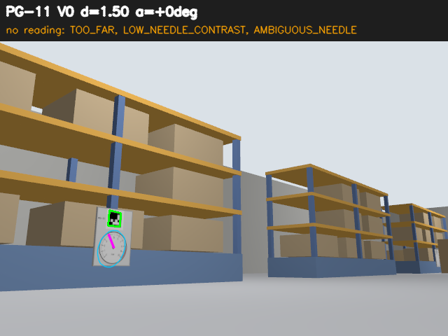

# InspectLoop Gauge Inspection Report — fault_injection_single_gauge

- **Mission ID:** `20261109_003951_00d8`
- **Mission state:** **COMPLETED**
- **Started (wall clock):** 2026-11-09T00:39:51
- **Duration:** 38.2 s sim time / 42.7 s wall time
- **Data source:** Gazebo Harmonic simulation. Every value below was read by OpenCV from simulated camera frames captured after the robot reached the viewpoint; the robot does not know the true gauge values.
- **Uncertainty:** sigma is a HEURISTIC uncertainty model (frame spread + pixel resolution + floor). It is a diagnostic, not a calibrated probability: no confidence level or coverage is claimed for value +/- k*sigma.
- **Acceptance rule:** heuristic sigma ≤ 0.15 , ≥ 3 valid frames of 5, no blocking quality flag; ≤ 1 RETRY_SAME per viewpoint, ≤ 3 viewpoints and ≤ 8 observations per gauge.

## Summary

Gauges: **1** — accepted **0**, unresolved **1**. Observations: 2, viewpoints visited: 1 (navigation succeeded 1, mean final position error 0.171 m).

Decisions: **RETRY_SAME** ×1, **UNRESOLVED** ×1

| Gauge | Result | Observations | Viewpoints | Decision sequence |
|---|---|---|---|---|
| PG-11 | UNRESOLVED [IMAGE_INVALID] — invalid image data (FROZEN_FRAMES) persisted: moving cannot fix it | 2 | 1 | RETRY_SAME → UNRESOLVED |

## PG-11 — Rack N1 - compressed-air header

**UNRESOLVED [IMAGE_INVALID] — invalid image data (FROZEN_FRAMES) persisted: moving cannot fix it**  
Footprint-clear viewpoint candidates: 15 (Nav2 path reachability not pre-checked), rejected by the map (collision/clearance): 0.

| t (s) | Viewpoint | Event | Value | σ (heuristic) | Quality flags | Decision | Reason |
|---|---|---|---|---|---|---|---|
| 16.0 | V0 d=1.50 a=+0deg | OBSERVATION #1 | - | - | TOO_FAR, LOW_NEEDLE_CONTRAST, AMBIGUOUS_NEEDLE, FROZEN_FRAMES | **RETRY_SAME** | possibly transient (FROZEN_FRAMES): observe again from the same pose |
| 18.5 | V0 d=1.50 a=+0deg | OBSERVATION #2 | - | - | TOO_FAR, LOW_NEEDLE_CONTRAST, AMBIGUOUS_NEEDLE, FROZEN_FRAMES | **UNRESOLVED** | invalid image data (FROZEN_FRAMES) persisted: moving cannot fix it |

- **V0 d=1.50 a=+0deg** at (-7.0, 2.49): navigation SUCCEEDED in 13.7 s, final error 0.171 m
  - obs #1: frames 0/5 valid (tag in 5), visibility 1.00, needle conf 0.18, view angle 39.8°, distance 4.08 m, dial radius 22.8 px → RETRY_SAME

    

  - obs #2: frames 0/5 valid (tag in 5), visibility 1.00, needle conf 0.18, view angle 39.8°, distance 4.08 m, dial radius 22.8 px → UNRESOLVED

    

## Return to home

SUCCEEDED (1 attempt(s)).

## System health events

| Sim time (s) | Component | Level | Message |
|---|---|---|---|
| 18.0 | inspectloop/stream/camera/image_raw | WARN | DEGRADED |
| 18.0 | inspectloop/stream/camera/camera_info | ERROR | STALE |
| 19.0 | inspectloop/stream/camera/image_raw | OK | OK |
