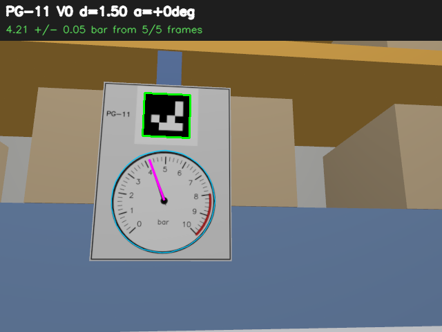

# InspectLoop Gauge Inspection Report — warehouse_pressure_round

- **Mission ID:** `20261115_124108_29fb`
- **Mission state:** **ABORTED** — interrupted (SIGINT)
- **Started (wall clock):** 2026-11-15T12:41:08
- **Duration:** 48.4 s sim time / 52.7 s wall time
- **Data source:** Gazebo Harmonic simulation. Every value below was read by OpenCV from simulated camera frames captured after the robot reached the viewpoint; the robot does not know the true gauge values.
- **Uncertainty:** sigma is a HEURISTIC uncertainty model (frame spread + pixel resolution + floor). It is a diagnostic, not a calibrated probability: no confidence level or coverage is claimed for value +/- k*sigma.
- **Acceptance rule:** heuristic sigma ≤ 0.15 , ≥ 3 valid frames of 5, no blocking quality flag; ≤ 1 RETRY_SAME per viewpoint, ≤ 3 viewpoints and ≤ 8 observations per gauge.

## Summary

Gauges: **1** — accepted **1**, unresolved **0**. Observations: 1, viewpoints visited: 1 (navigation succeeded 1, mean final position error 0.129 m).

Decisions: **ACCEPT** ×1

| Gauge | Result | Observations | Viewpoints | Decision sequence |
|---|---|---|---|---|
| PG-11 | 4.21 bar (heuristic σ 0.05), alarm NORMAL | 1 | 1 | ACCEPT |

## PG-11 — Rack N1 - compressed-air header

**4.21 bar (heuristic σ 0.05), alarm NORMAL**  
Footprint-clear viewpoint candidates: 15 (Nav2 path reachability not pre-checked), rejected by the map (collision/clearance): 0.

| t (s) | Viewpoint | Event | Value | σ (heuristic) | Quality flags | Decision | Reason |
|---|---|---|---|---|---|---|---|
| 16.7 | V0 d=1.50 a=+0deg | OBSERVATION #1 | 4.206 | 0.052 | - | **ACCEPT** | 5 valid frames, sigma 0.052 <= 0.15 |

- **V0 d=1.50 a=+0deg** at (-7.0, 2.49): navigation SUCCEEDED in 14.2 s, final error 0.129 m
  - obs #1: frames 5/5 valid (tag in 5), visibility 1.00, needle conf 0.99, view angle 21.8°, distance 1.23 m, dial radius 74.4 px → ACCEPT

    

## System health events

No health level changes were recorded during the mission.
