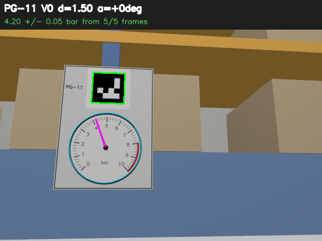
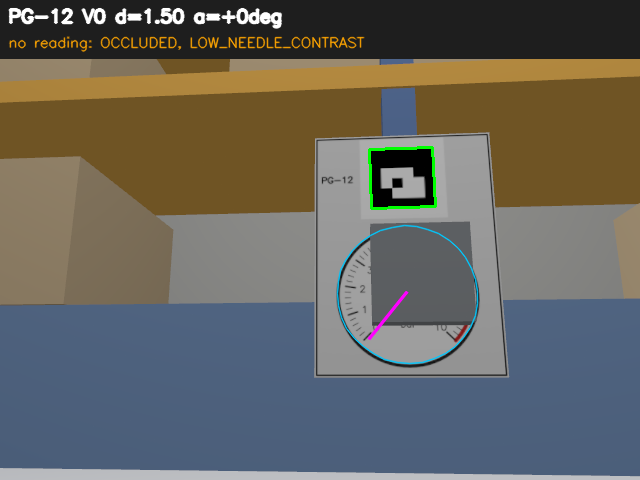
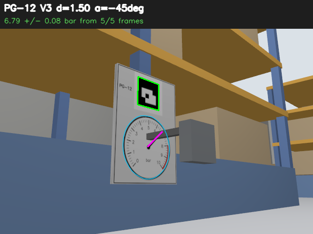
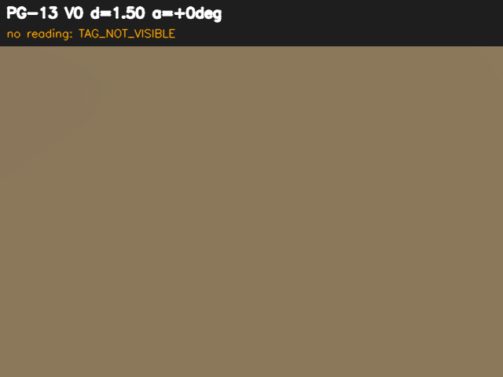
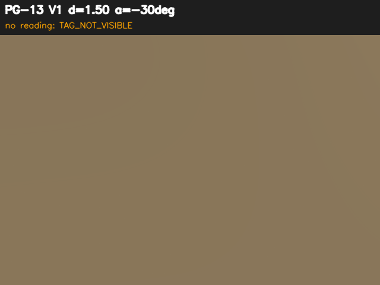
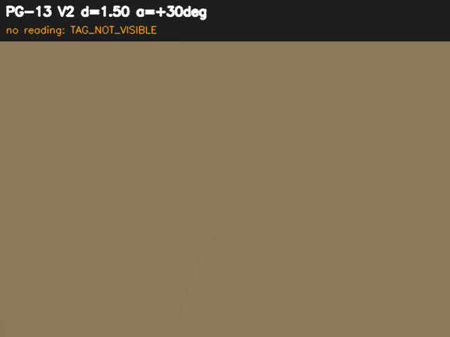
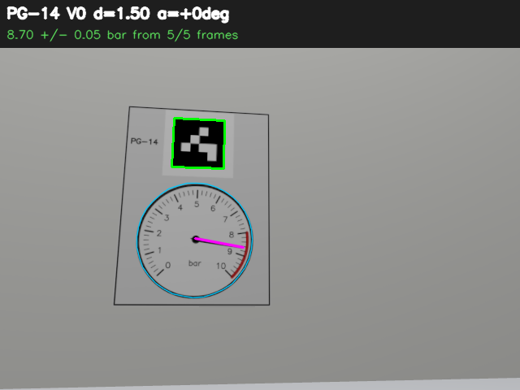

# InspectLoop Gauge Inspection Report — warehouse_pressure_round

- **Mission ID:** `20261108_163623_2a10`
- **Mission state:** **COMPLETED**
- **Started (wall clock):** 2026-11-08T16:36:23
- **Duration:** 204.4 s sim time / 234.1 s wall time
- **Data source:** Gazebo Harmonic simulation. Every value below was read by OpenCV from simulated camera frames captured after the robot reached the viewpoint; the robot does not know the true gauge values.
- **Acceptance rule:** sigma ≤ 0.15 , ≥ 3 valid frames of 5, no blocking quality flag; ≤ 1 RETRY_SAME per viewpoint, ≤ 3 viewpoints and ≤ 8 observations per gauge.

## Summary

Gauges: **4** — accepted **3**, unresolved **1**. Observations: 10, viewpoints visited: 7 (navigation succeeded 7, mean final position error 0.083 m).

Decisions: **ACCEPT** ×3, **MOVE_NEW** ×3, **RETRY_SAME** ×3, **UNRESOLVED** ×1

**Alarm limits exceeded:** PG-14

**Recovered by autonomous viewpoint change:** PG-12

| Gauge | Result | Observations | Viewpoints | Decision sequence |
|---|---|---|---|---|
| PG-11 | 4.20 ± 0.11 bar (95%), alarm NORMAL | 1 | 1 | ACCEPT |
| PG-12 | 6.79 ± 0.15 bar (95%), alarm NORMAL | 2 | 2 | MOVE_NEW → ACCEPT |
| PG-13 | UNRESOLVED — TAG_NOT_VISIBLE persisted and no viewpoint/observation budget left | 6 | 3 | RETRY_SAME → MOVE_NEW → RETRY_SAME → MOVE_NEW → RETRY_SAME → UNRESOLVED |
| PG-14 | 8.70 ± 0.11 bar (95%), alarm HIGH | 1 | 1 | ACCEPT |

## PG-11 — Rack N1 - compressed-air header

**4.20 ± 0.11 bar (95%), alarm NORMAL**  
Feasible viewpoint candidates: 15, rejected by the map (collision/clearance): 0.

| t (s) | Viewpoint | Event | Value | σ | Quality flags | Decision | Reason |
|---|---|---|---|---|---|---|---|
| 16.4 | V0 d=1.50 a=+0deg | OBSERVATION #1 | 4.205 | 0.054 | - | **ACCEPT** | 5 valid frames, sigma 0.054 <= 0.15 |

- **V0 d=1.50 a=+0deg** at (-7.0, 2.49): navigation SUCCEEDED in 13.8 s, final error 0.085 m
  - obs #1: frames 5/5 valid (tag in 5), visibility 1.00, needle conf 0.98, view angle 21.2°, distance 1.29 m, dial radius 70.8 px → ACCEPT

    

## PG-12 — Rack S2 - hydraulic accumulator

**6.79 ± 0.15 bar (95%), alarm NORMAL**  
Feasible viewpoint candidates: 15, rejected by the map (collision/clearance): 0.

| t (s) | Viewpoint | Event | Value | σ | Quality flags | Decision | Reason |
|---|---|---|---|---|---|---|---|
| 31.4 | V0 d=1.50 a=+0deg | OBSERVATION #1 | - | - | OCCLUDED, LOW_NEEDLE_CONTRAST | **MOVE_NEW** | viewpoint-dependent problem (LOW_NEEDLE_CONTRAST, OCCLUDED) (hint: different_side) |
| 44.2 | V3 d=1.50 a=-45deg | OBSERVATION #2 | 6.792 | 0.076 | - | **ACCEPT** | 5 valid frames, sigma 0.076 <= 0.15 |

- **V0 d=1.50 a=+0deg** at (-1.0, -2.49): navigation SUCCEEDED in 28.7 s, final error 0.124 m
  - obs #1: frames 0/5 valid (tag in 5), visibility 0.01, needle conf 0.01, view angle 21.3°, distance 1.29 m, dial radius 69.6 px → MOVE_NEW

    

- **V3 d=1.50 a=-45deg** at (0.061, -2.929): navigation SUCCEEDED in 10.1 s, final error 0.084 m
  - obs #2: frames 5/5 valid (tag in 5), visibility 0.87, needle conf 0.46, view angle 46.4°, distance 1.39 m, dial radius 56.5 px → ACCEPT

    

## PG-13 — Rack N3 - sprinkler riser

**UNRESOLVED — TAG_NOT_VISIBLE persisted and no viewpoint/observation budget left**  
Feasible viewpoint candidates: 8, rejected by the map (collision/clearance): 7.

| t (s) | Viewpoint | Event | Value | σ | Quality flags | Decision | Reason |
|---|---|---|---|---|---|---|---|
| 27.2 | V0 d=1.50 a=+0deg | OBSERVATION #1 | - | - | TAG_NOT_VISIBLE | **RETRY_SAME** | possibly transient (TAG_NOT_VISIBLE): observe again from the same pose |
| 29.5 | V0 d=1.50 a=+0deg | OBSERVATION #2 | - | - | TAG_NOT_VISIBLE | **MOVE_NEW** | TAG_NOT_VISIBLE persisted after 1 retry(ies) (hint: different_side) |
| 41.0 | V1 d=1.50 a=-30deg | OBSERVATION #3 | - | - | TAG_NOT_VISIBLE | **RETRY_SAME** | possibly transient (TAG_NOT_VISIBLE): observe again from the same pose |
| 43.4 | V1 d=1.50 a=-30deg | OBSERVATION #4 | - | - | TAG_NOT_VISIBLE | **MOVE_NEW** | TAG_NOT_VISIBLE persisted after 1 retry(ies) (hint: different_side) |
| 57.0 | V2 d=1.50 a=+30deg | OBSERVATION #5 | - | - | TAG_NOT_VISIBLE | **RETRY_SAME** | possibly transient (TAG_NOT_VISIBLE): observe again from the same pose |
| 59.6 | V2 d=1.50 a=+30deg | OBSERVATION #6 | - | - | TAG_NOT_VISIBLE | **UNRESOLVED** | TAG_NOT_VISIBLE persisted and no viewpoint/observation budget left |

- **V0 d=1.50 a=+0deg** at (5.0, 2.49): navigation SUCCEEDED in 26.0 s, final error 0.156 m
  - obs #1: frames 0/5 valid (tag in 0), visibility 0.00, needle conf 0.00, view angle -°, distance - m, dial radius 0.0 px → RETRY_SAME

    

  - obs #2: frames 0/5 valid (tag in 0), visibility 0.00, needle conf 0.00, view angle -°, distance - m, dial radius 0.0 px → MOVE_NEW

    

- **V1 d=1.50 a=-30deg** at (4.25, 2.691): navigation SUCCEEDED in 9.8 s, final error 0.046 m
  - obs #3: frames 0/5 valid (tag in 0), visibility 0.00, needle conf 0.00, view angle -°, distance - m, dial radius 0.0 px → RETRY_SAME

    

  - obs #4: frames 0/5 valid (tag in 0), visibility 0.00, needle conf 0.00, view angle -°, distance - m, dial radius 0.0 px → MOVE_NEW

    

- **V2 d=1.50 a=+30deg** at (5.75, 2.691): navigation SUCCEEDED in 12.0 s, final error 0.048 m
  - obs #5: frames 0/5 valid (tag in 0), visibility 0.00, needle conf 0.00, view angle -°, distance - m, dial radius 0.0 px → RETRY_SAME

    

  - obs #6: frames 0/5 valid (tag in 0), visibility 0.00, needle conf 0.00, view angle -°, distance - m, dial radius 0.0 px → UNRESOLVED

    

## PG-14 — East wall - boiler feed line

**8.70 ± 0.11 bar (95%), alarm HIGH**  
Feasible viewpoint candidates: 15, rejected by the map (collision/clearance): 0.

| t (s) | Viewpoint | Event | Value | σ | Quality flags | Decision | Reason |
|---|---|---|---|---|---|---|---|
| 22.2 | V0 d=1.50 a=+0deg | OBSERVATION #1 | 8.701 | 0.054 | - | **ACCEPT** | 5 valid frames, sigma 0.054 <= 0.15 |

- **V0 d=1.50 a=+0deg** at (10.29, -0.0): navigation SUCCEEDED in 20.2 s, final error 0.037 m
  - obs #1: frames 5/5 valid (tag in 5), visibility 0.99, needle conf 0.96, view angle 20.3°, distance 1.29 m, dial radius 70.8 px → ACCEPT

    

## Return to home

SUCCEEDED (1 attempt(s)).

## System health events

| Sim time (s) | Component | Level | Message |
|---|---|---|---|
| 11.0 | inspectloop/stream/camera/image_raw | WARN | DEGRADED |
| 12.0 | inspectloop/stream/camera/image_raw | OK | OK |
| 14.0 | inspectloop/stream/camera/image_raw | WARN | DEGRADED |
| 15.0 | inspectloop/stream/camera/image_raw | OK | OK |
| 18.0 | inspectloop/stream/camera/image_raw | WARN | DEGRADED |
| 20.0 | inspectloop/stream/camera/image_raw | OK | OK |
| 22.0 | inspectloop/stream/camera/image_raw | WARN | DEGRADED |
| 25.0 | inspectloop/stream/camera/image_raw | OK | OK |
| 28.0 | inspectloop/stream/camera/image_raw | WARN | DEGRADED |
| 30.0 | inspectloop/stream/camera/image_raw | OK | OK |
| 39.0 | inspectloop/stream/camera/image_raw | WARN | DEGRADED |
| 40.0 | inspectloop/stream/camera/image_raw | OK | OK |
| 60.0 | inspectloop/stream/camera/image_raw | WARN | DEGRADED |
| 62.0 | inspectloop/stream/camera/image_raw | OK | OK |
| 78.0 | inspectloop/stream/camera/image_raw | WARN | DEGRADED |
| 80.0 | inspectloop/stream/camera/image_raw | OK | OK |
| 82.0 | inspectloop/stream/camera/image_raw | WARN | DEGRADED |
| 84.0 | inspectloop/stream/camera/image_raw | OK | OK |
| 85.0 | inspectloop/stream/camera/image_raw | WARN | DEGRADED |
| 87.0 | inspectloop/stream/camera/image_raw | OK | OK |
| 88.0 | inspectloop/stream/camera/image_raw | WARN | DEGRADED |
| 89.0 | inspectloop/stream/camera/image_raw | OK | OK |
| 94.0 | inspectloop/stream/camera/image_raw | WARN | DEGRADED |
| 95.0 | inspectloop/stream/camera/image_raw | OK | OK |
| 96.0 | inspectloop/stream/camera/image_raw | WARN | DEGRADED |
| 100.0 | inspectloop/stream/camera/image_raw | OK | OK |
| 103.0 | inspectloop/stream/camera/image_raw | WARN | DEGRADED |
| 112.0 | inspectloop/stream/camera/image_raw | OK | OK |
| 117.0 | inspectloop/stream/camera/image_raw | WARN | DEGRADED |
| 121.0 | inspectloop/stream/camera/image_raw | OK | OK |
| 122.0 | inspectloop/stream/camera/image_raw | WARN | DEGRADED |
| 124.0 | inspectloop/stream/camera/image_raw | OK | OK |
| 128.0 | inspectloop/stream/camera/image_raw | WARN | DEGRADED |
| 129.0 | inspectloop/stream/camera/image_raw | OK | OK |
| 131.0 | inspectloop/stream/camera/image_raw | WARN | DEGRADED |
| 132.0 | inspectloop/stream/camera/image_raw | OK | OK |
| 133.0 | inspectloop/stream/camera/image_raw | WARN | DEGRADED |
| 137.0 | inspectloop/stream/camera/image_raw | OK | OK |
| 138.0 | inspectloop/stream/camera/image_raw | WARN | DEGRADED |
| 143.0 | inspectloop/stream/camera/image_raw | OK | OK |
| 144.0 | inspectloop/stream/camera/image_raw | WARN | DEGRADED |
| 147.0 | inspectloop/stream/camera/image_raw | OK | OK |
| 151.0 | inspectloop/stream/camera/image_raw | WARN | DEGRADED |
| 153.0 | inspectloop/stream/camera/image_raw | OK | OK |
| 159.0 | inspectloop/stream/camera/image_raw | WARN | DEGRADED |
| 164.0 | inspectloop/stream/camera/image_raw | OK | OK |
| 168.0 | inspectloop/stream/camera/image_raw | WARN | DEGRADED |
| 169.0 | inspectloop/stream/camera/image_raw | OK | OK |
| 176.0 | inspectloop/stream/camera/image_raw | WARN | DEGRADED |
| 179.0 | inspectloop/stream/camera/image_raw | OK | OK |
| 181.0 | inspectloop/stream/camera/image_raw | WARN | DEGRADED |
| 182.0 | inspectloop/stream/camera/image_raw | OK | OK |
| 184.0 | inspectloop/stream/camera/image_raw | WARN | DEGRADED |
| 186.0 | inspectloop/stream/camera/image_raw | OK | OK |
| 191.0 | inspectloop/stream/camera/image_raw | WARN | DEGRADED |
| 192.0 | inspectloop/stream/camera/image_raw | OK | OK |
| 193.0 | inspectloop/stream/camera/image_raw | WARN | DEGRADED |
| 199.0 | inspectloop/stream/camera/image_raw | ERROR | STALE |
| 200.0 | inspectloop/stream/camera/image_raw | OK | OK |
| 205.0 | inspectloop/stream/camera/image_raw | WARN | DEGRADED |
| 206.0 | inspectloop/stream/camera/image_raw | OK | OK |
| 207.0 | inspectloop/stream/camera/image_raw | WARN | DEGRADED |
| 208.0 | inspectloop/stream/camera/image_raw | OK | OK |
| 211.0 | inspectloop/stream/camera/image_raw | WARN | DEGRADED |
| 213.0 | inspectloop/stream/camera/image_raw | OK | OK |
| 215.0 | inspectloop/stream/camera/image_raw | WARN | DEGRADED |
