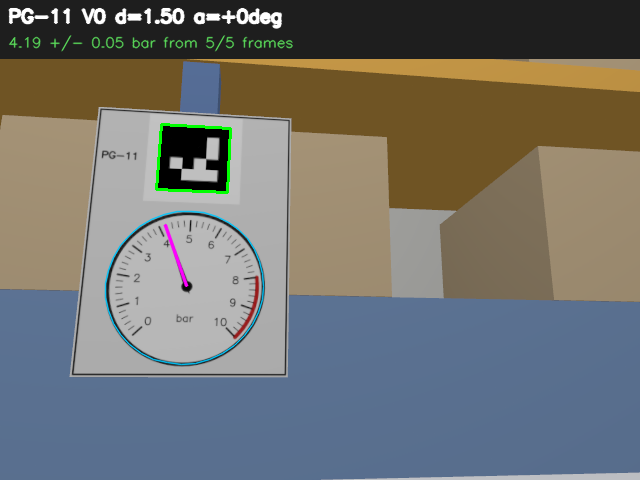
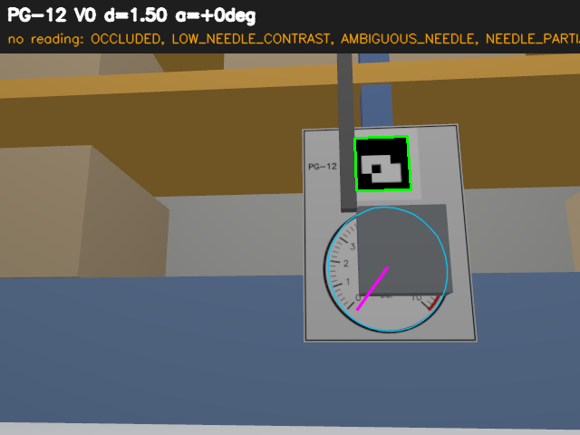
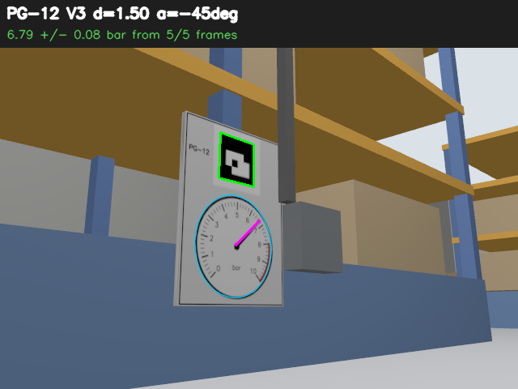
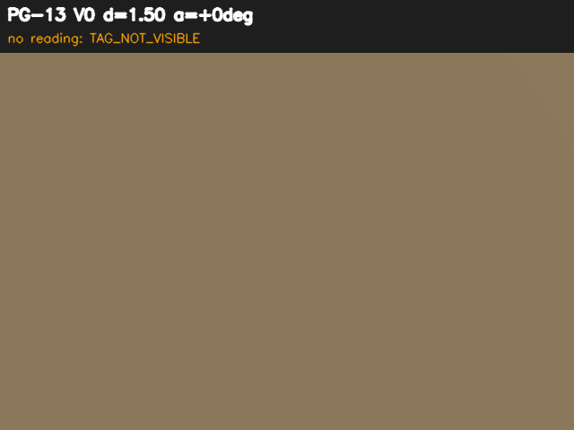
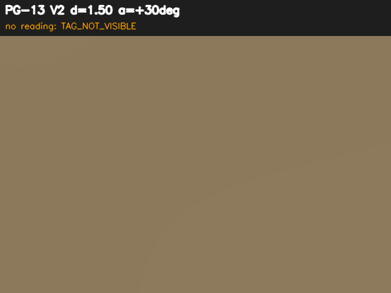
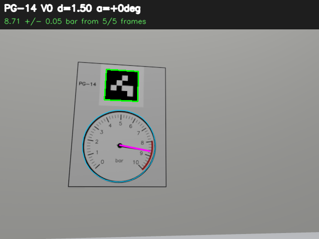

# InspectLoop Gauge Inspection Report — warehouse_pressure_round

- **Mission ID:** `20261109_004411_d64d`
- **Mission state:** **COMPLETED**
- **Started (wall clock):** 2026-11-09T00:44:11
- **Duration:** 214.3 s sim time / 227.4 s wall time
- **Data source:** Gazebo Harmonic simulation. Every value below was read by OpenCV from simulated camera frames captured after the robot reached the viewpoint; the robot does not know the true gauge values.
- **Uncertainty:** sigma is a HEURISTIC uncertainty model (frame spread + pixel resolution + floor). It is a diagnostic, not a calibrated probability: no confidence level or coverage is claimed for value +/- k*sigma.
- **Acceptance rule:** heuristic sigma ≤ 0.15 , ≥ 3 valid frames of 5, no blocking quality flag; ≤ 1 RETRY_SAME per viewpoint, ≤ 3 viewpoints and ≤ 8 observations per gauge.

## Summary

Gauges: **4** — accepted **3**, unresolved **1**. Observations: 10, viewpoints visited: 7 (navigation succeeded 7, mean final position error 0.104 m).

Decisions: **ACCEPT** ×3, **MOVE_NEW** ×3, **RETRY_SAME** ×3, **UNRESOLVED** ×1

**Alarm limits exceeded:** PG-14

**Recovered by autonomous viewpoint change:** PG-12

| Gauge | Result | Observations | Viewpoints | Decision sequence |
|---|---|---|---|---|
| PG-11 | 4.19 bar (heuristic σ 0.05), alarm NORMAL | 1 | 1 | ACCEPT |
| PG-12 | 6.79 bar (heuristic σ 0.08), alarm NORMAL | 2 | 2 | MOVE_NEW → ACCEPT |
| PG-13 | UNRESOLVED [INSUFFICIENT_VISUAL_EVIDENCE] — TAG_NOT_VISIBLE persisted and no viewpoint/observation budget left | 6 | 3 | RETRY_SAME → MOVE_NEW → RETRY_SAME → MOVE_NEW → RETRY_SAME → UNRESOLVED |
| PG-14 | 8.71 bar (heuristic σ 0.05), alarm HIGH | 1 | 1 | ACCEPT |

## PG-11 — Rack N1 - compressed-air header

**4.19 bar (heuristic σ 0.05), alarm NORMAL**  
Footprint-clear viewpoint candidates: 15 (Nav2 path reachability not pre-checked), rejected by the map (collision/clearance): 0.

| t (s) | Viewpoint | Event | Value | σ (heuristic) | Quality flags | Decision | Reason |
|---|---|---|---|---|---|---|---|
| 16.9 | V0 d=1.50 a=+0deg | OBSERVATION #1 | 4.192 | 0.051 | - | **ACCEPT** | 5 valid frames, sigma 0.051 <= 0.15 |

- **V0 d=1.50 a=+0deg** at (-7.0, 2.49): navigation SUCCEEDED in 14.3 s, final error 0.163 m
  - obs #1: frames 5/5 valid (tag in 5), visibility 1.00, needle conf 0.99, view angle 22.7°, distance 1.20 m, dial radius 77.8 px → ACCEPT

    

## PG-12 — Rack S2 - hydraulic accumulator

**6.79 bar (heuristic σ 0.08), alarm NORMAL**  
Footprint-clear viewpoint candidates: 15 (Nav2 path reachability not pre-checked), rejected by the map (collision/clearance): 0.

| t (s) | Viewpoint | Event | Value | σ (heuristic) | Quality flags | Decision | Reason |
|---|---|---|---|---|---|---|---|
| 31.5 | V0 d=1.50 a=+0deg | OBSERVATION #1 | - | - | OCCLUDED, LOW_NEEDLE_CONTRAST, AMBIGUOUS_NEEDLE, NEEDLE_PARTIAL | **MOVE_NEW** | viewpoint-dependent problem (AMBIGUOUS_NEEDLE, LOW_NEEDLE_CONTRAST, NEEDLE_PARTIAL, OCCLUDED) (hint: different_side) |
| 45.1 | V3 d=1.50 a=-45deg | OBSERVATION #2 | 6.787 | 0.076 | - | **ACCEPT** | 5 valid frames, sigma 0.076 <= 0.15 |

- **V0 d=1.50 a=+0deg** at (-1.0, -2.49): navigation SUCCEEDED in 29.1 s, final error 0.135 m
  - obs #1: frames 0/5 valid (tag in 5), visibility 0.01, needle conf 0.00, view angle 15.6°, distance 1.38 m, dial radius 67.2 px → MOVE_NEW

    

- **V3 d=1.50 a=-45deg** at (0.061, -2.929): navigation SUCCEEDED in 10.2 s, final error 0.063 m
  - obs #2: frames 5/5 valid (tag in 5), visibility 1.00, needle conf 0.98, view angle 44.8°, distance 1.42 m, dial radius 55.5 px → ACCEPT

    

## PG-13 — Rack N3 - sprinkler riser

**UNRESOLVED [INSUFFICIENT_VISUAL_EVIDENCE] — TAG_NOT_VISIBLE persisted and no viewpoint/observation budget left**  
Footprint-clear viewpoint candidates: 8 (Nav2 path reachability not pre-checked), rejected by the map (collision/clearance): 7.

| t (s) | Viewpoint | Event | Value | σ (heuristic) | Quality flags | Decision | Reason |
|---|---|---|---|---|---|---|---|
| 28.9 | V0 d=1.50 a=+0deg | OBSERVATION #1 | - | - | TAG_NOT_VISIBLE | **RETRY_SAME** | possibly transient (TAG_NOT_VISIBLE): observe again from the same pose |
| 31.7 | V0 d=1.50 a=+0deg | OBSERVATION #2 | - | - | TAG_NOT_VISIBLE | **MOVE_NEW** | TAG_NOT_VISIBLE persisted after 1 retry(ies) (hint: different_side) |
| 44.9 | V1 d=1.50 a=-30deg | OBSERVATION #3 | - | - | TAG_NOT_VISIBLE | **RETRY_SAME** | possibly transient (TAG_NOT_VISIBLE): observe again from the same pose |
| 47.9 | V1 d=1.50 a=-30deg | OBSERVATION #4 | - | - | TAG_NOT_VISIBLE | **MOVE_NEW** | TAG_NOT_VISIBLE persisted after 1 retry(ies) (hint: different_side) |
| 61.0 | V2 d=1.50 a=+30deg | OBSERVATION #5 | - | - | TAG_NOT_VISIBLE | **RETRY_SAME** | possibly transient (TAG_NOT_VISIBLE): observe again from the same pose |
| 63.5 | V2 d=1.50 a=+30deg | OBSERVATION #6 | - | - | TAG_NOT_VISIBLE | **UNRESOLVED** | TAG_NOT_VISIBLE persisted and no viewpoint/observation budget left |

- **V0 d=1.50 a=+0deg** at (5.0, 2.49): navigation SUCCEEDED in 26.4 s, final error 0.158 m
  - obs #1: frames 0/5 valid (tag in 0), visibility 0.00, needle conf 0.00, view angle -°, distance - m, dial radius 0.0 px → RETRY_SAME

    

  - obs #2: frames 0/5 valid (tag in 0), visibility 0.00, needle conf 0.00, view angle -°, distance - m, dial radius 0.0 px → MOVE_NEW

    

- **V1 d=1.50 a=-30deg** at (4.25, 2.691): navigation SUCCEEDED in 10.9 s, final error 0.072 m
  - obs #3: frames 0/5 valid (tag in 0), visibility 0.00, needle conf 0.00, view angle -°, distance - m, dial radius 0.0 px → RETRY_SAME

    

  - obs #4: frames 0/5 valid (tag in 0), visibility 0.00, needle conf 0.00, view angle -°, distance - m, dial radius 0.0 px → MOVE_NEW

    

- **V2 d=1.50 a=+30deg** at (5.75, 2.691): navigation SUCCEEDED in 11.0 s, final error 0.056 m
  - obs #5: frames 0/5 valid (tag in 0), visibility 0.00, needle conf 0.00, view angle -°, distance - m, dial radius 0.0 px → RETRY_SAME

    

  - obs #6: frames 0/5 valid (tag in 0), visibility 0.00, needle conf 0.00, view angle -°, distance - m, dial radius 0.0 px → UNRESOLVED

    

## PG-14 — East wall - boiler feed line

**8.71 bar (heuristic σ 0.05), alarm HIGH**  
Footprint-clear viewpoint candidates: 15 (Nav2 path reachability not pre-checked), rejected by the map (collision/clearance): 0.

| t (s) | Viewpoint | Event | Value | σ (heuristic) | Quality flags | Decision | Reason |
|---|---|---|---|---|---|---|---|
| 23.3 | V0 d=1.50 a=+0deg | OBSERVATION #1 | 8.710 | 0.053 | - | **ACCEPT** | 5 valid frames, sigma 0.053 <= 0.15 |

- **V0 d=1.50 a=+0deg** at (10.29, -0.0): navigation SUCCEEDED in 20.9 s, final error 0.079 m
  - obs #1: frames 5/5 valid (tag in 5), visibility 1.00, needle conf 0.98, view angle 21.3°, distance 1.25 m, dial radius 72.8 px → ACCEPT

    

## Return to home

SUCCEEDED (1 attempt(s)).

## System health events

| Sim time (s) | Component | Level | Message |
|---|---|---|---|
| 72.0 | inspectloop/stream/camera/image_raw | WARN | DEGRADED |
| 73.0 | inspectloop/stream/camera/image_raw | OK | OK |
| 220.0 | inspectloop/stream/camera/image_raw | WARN | DEGRADED |
| 221.0 | inspectloop/stream/camera/image_raw | OK | OK |
