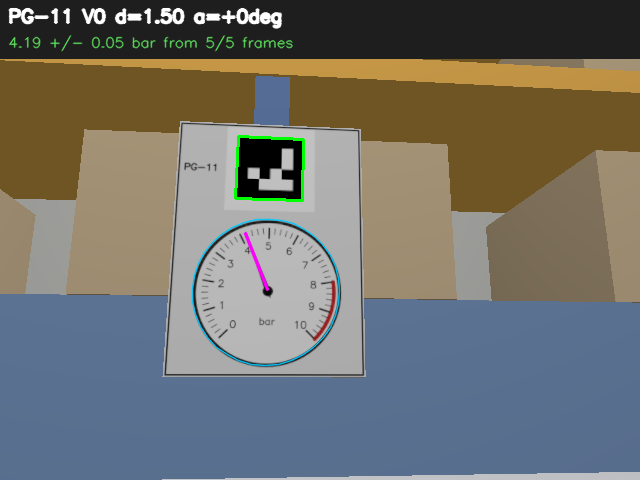
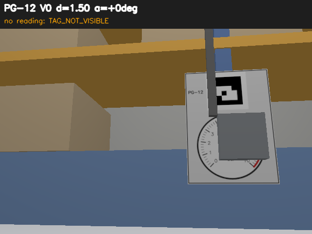
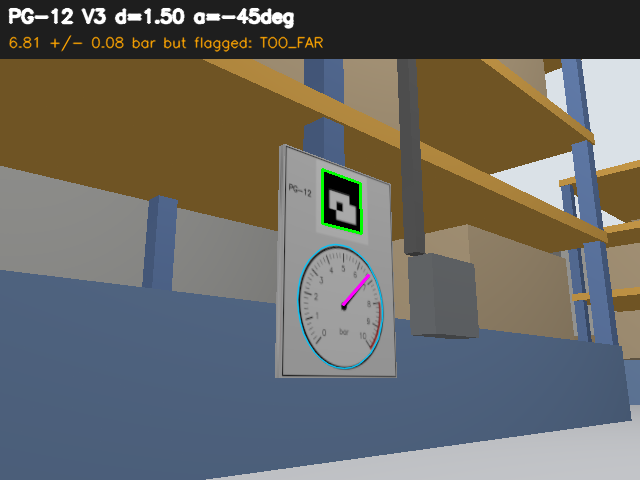
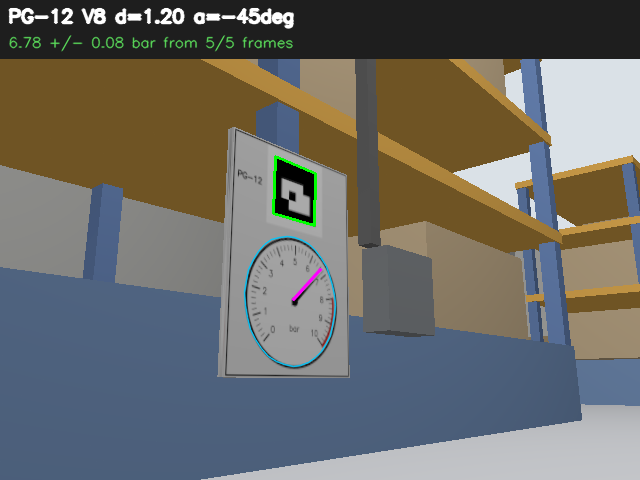
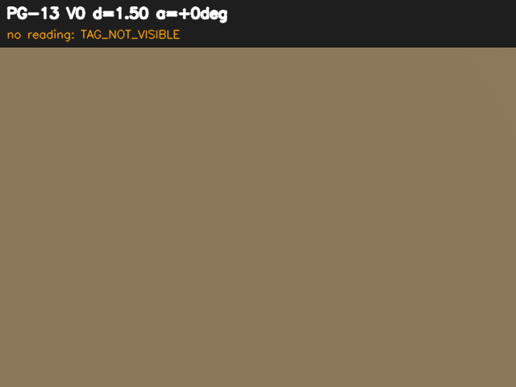
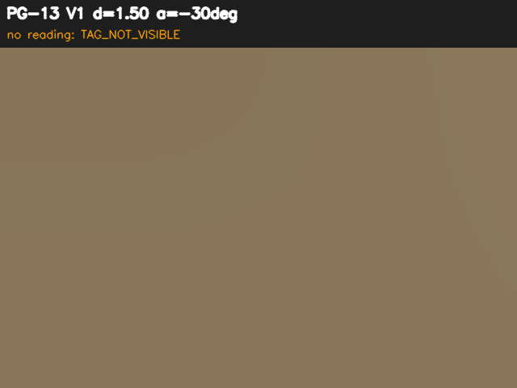
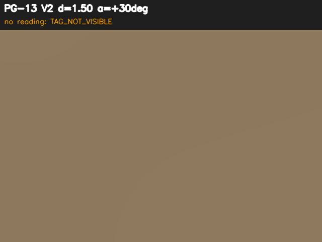
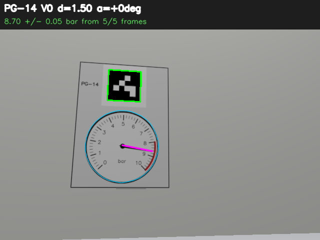

# InspectLoop Gauge Inspection Report — warehouse_pressure_round

- **Mission ID:** `20261115_140724_e358`
- **Mission state:** **COMPLETED**
- **Started (wall clock):** 2026-11-15T14:07:24
- **Duration:** 229.5 s sim time / 452.0 s wall time
- **Data source:** Gazebo Harmonic simulation. Every value below was read by OpenCV from simulated camera frames captured after the robot reached the viewpoint; the robot does not know the true gauge values.
- **Uncertainty:** sigma is a HEURISTIC uncertainty model (frame spread + pixel resolution + floor). It is a diagnostic, not a calibrated probability: no confidence level or coverage is claimed for value +/- k*sigma.
- **Acceptance rule:** heuristic sigma ≤ 0.15 , ≥ 3 valid frames of 5, no blocking quality flag; ≤ 1 RETRY_SAME per viewpoint, ≤ 3 viewpoints and ≤ 8 observations per gauge.

## Summary

Gauges: **4** — accepted **3**, unresolved **1**. Observations: 12, viewpoints visited: 8 (navigation succeeded 8, mean final position error 0.103 m).

Decisions: **ACCEPT** ×3, **RETRY_SAME** ×4, **MOVE_NEW** ×4, **UNRESOLVED** ×1

**Alarm limits exceeded:** PG-14

**Recovered by autonomous viewpoint change:** PG-12

| Gauge | Result | Observations | Viewpoints | Decision sequence |
|---|---|---|---|---|
| PG-11 | 4.19 bar (heuristic σ 0.05), alarm NORMAL | 1 | 1 | ACCEPT |
| PG-12 | 6.78 bar (heuristic σ 0.08), alarm NORMAL | 4 | 3 | RETRY_SAME → MOVE_NEW → MOVE_NEW → ACCEPT |
| PG-13 | UNRESOLVED [INSUFFICIENT_VISUAL_EVIDENCE] — TAG_NOT_VISIBLE persisted and no viewpoint/observation budget left | 6 | 3 | RETRY_SAME → MOVE_NEW → RETRY_SAME → MOVE_NEW → RETRY_SAME → UNRESOLVED |
| PG-14 | 8.70 bar (heuristic σ 0.05), alarm HIGH | 1 | 1 | ACCEPT |

## PG-11 — Rack N1 - compressed-air header

**4.19 bar (heuristic σ 0.05), alarm NORMAL**  
Footprint-clear viewpoint candidates: 15 (Nav2 path reachability not pre-checked), rejected by the map (collision/clearance): 0.

| t (s) | Viewpoint | Event | Value | σ (heuristic) | Quality flags | Decision | Reason |
|---|---|---|---|---|---|---|---|
| 15.6 | V0 d=1.50 a=+0deg | OBSERVATION #1 | 4.189 | 0.052 | - | **ACCEPT** | 5 valid frames, sigma 0.052 <= 0.15 |

- **V0 d=1.50 a=+0deg** at (-7.0, 2.49): navigation SUCCEEDED in 13.6 s, final error 0.152 m
  - obs #1: frames 5/5 valid (tag in 5), visibility 1.00, needle conf 0.99, view angle 21.6°, distance 1.23 m, dial radius 73.5 px → ACCEPT

    

## PG-12 — Rack S2 - hydraulic accumulator

**6.78 bar (heuristic σ 0.08), alarm NORMAL**  
Footprint-clear viewpoint candidates: 15 (Nav2 path reachability not pre-checked), rejected by the map (collision/clearance): 0.

| t (s) | Viewpoint | Event | Value | σ (heuristic) | Quality flags | Decision | Reason |
|---|---|---|---|---|---|---|---|
| 31.1 | V0 d=1.50 a=+0deg | OBSERVATION #1 | - | - | TAG_NOT_VISIBLE | **RETRY_SAME** | possibly transient (TAG_NOT_VISIBLE): observe again from the same pose |
| 34.8 | V0 d=1.50 a=+0deg | OBSERVATION #2 | - | - | TAG_NOT_VISIBLE | **MOVE_NEW** | TAG_NOT_VISIBLE persisted after 1 retry(ies) (hint: different_side) |
| 51.4 | V3 d=1.50 a=-45deg | OBSERVATION #3 | 6.806 | 0.083 | TOO_FAR | **MOVE_NEW** | viewpoint-dependent problem (TOO_FAR) (hint: closer) |
| 55.9 | V8 d=1.20 a=-45deg | OBSERVATION #4 | 6.783 | 0.079 | - | **ACCEPT** | 5 valid frames, sigma 0.079 <= 0.15 |

- **V0 d=1.50 a=+0deg** at (-1.0, -2.49): navigation SUCCEEDED in 28.2 s, final error 0.088 m
  - obs #1: frames 0/5 valid (tag in 0), visibility 0.00, needle conf 0.00, view angle -°, distance - m, dial radius 0.0 px → RETRY_SAME

    

  - obs #2: frames 0/5 valid (tag in 0), visibility 0.00, needle conf 0.00, view angle -°, distance - m, dial radius 0.0 px → MOVE_NEW

    

- **V3 d=1.50 a=-45deg** at (0.061, -2.929): navigation SUCCEEDED in 10.2 s, final error 0.045 m
  - obs #3: frames 4/4 valid (tag in 4), visibility 1.00, needle conf 0.97, view angle 49.1°, distance 1.47 m, dial radius 52.5 px → MOVE_NEW

    

- **V8 d=1.20 a=-45deg** at (-0.151, -3.141): navigation SUCCEEDED in 1.2 s, final error 0.194 m
  - obs #4: frames 5/5 valid (tag in 5), visibility 1.00, needle conf 0.98, view angle 48.7°, distance 1.39 m, dial radius 55.4 px → ACCEPT

    

## PG-13 — Rack N3 - sprinkler riser

**UNRESOLVED [INSUFFICIENT_VISUAL_EVIDENCE] — TAG_NOT_VISIBLE persisted and no viewpoint/observation budget left**  
Footprint-clear viewpoint candidates: 8 (Nav2 path reachability not pre-checked), rejected by the map (collision/clearance): 7.

| t (s) | Viewpoint | Event | Value | σ (heuristic) | Quality flags | Decision | Reason |
|---|---|---|---|---|---|---|---|
| 29.9 | V0 d=1.50 a=+0deg | OBSERVATION #1 | - | - | TAG_NOT_VISIBLE | **RETRY_SAME** | possibly transient (TAG_NOT_VISIBLE): observe again from the same pose |
| 33.0 | V0 d=1.50 a=+0deg | OBSERVATION #2 | - | - | TAG_NOT_VISIBLE | **MOVE_NEW** | TAG_NOT_VISIBLE persisted after 1 retry(ies) (hint: different_side) |
| 45.6 | V1 d=1.50 a=-30deg | OBSERVATION #3 | - | - | TAG_NOT_VISIBLE | **RETRY_SAME** | possibly transient (TAG_NOT_VISIBLE): observe again from the same pose |
| 49.7 | V1 d=1.50 a=-30deg | OBSERVATION #4 | - | - | TAG_NOT_VISIBLE | **MOVE_NEW** | TAG_NOT_VISIBLE persisted after 1 retry(ies) (hint: different_side) |
| 65.7 | V2 d=1.50 a=+30deg | OBSERVATION #5 | - | - | TAG_NOT_VISIBLE | **RETRY_SAME** | possibly transient (TAG_NOT_VISIBLE): observe again from the same pose |
| 69.8 | V2 d=1.50 a=+30deg | OBSERVATION #6 | - | - | TAG_NOT_VISIBLE | **UNRESOLVED** | TAG_NOT_VISIBLE persisted and no viewpoint/observation budget left |

- **V0 d=1.50 a=+0deg** at (5.0, 2.49): navigation SUCCEEDED in 26.4 s, final error 0.116 m
  - obs #1: frames 0/5 valid (tag in 0), visibility 0.00, needle conf 0.00, view angle -°, distance - m, dial radius 0.0 px → RETRY_SAME

    

  - obs #2: frames 0/5 valid (tag in 0), visibility 0.00, needle conf 0.00, view angle -°, distance - m, dial radius 0.0 px → MOVE_NEW

    

- **V1 d=1.50 a=-30deg** at (4.25, 2.691): navigation SUCCEEDED in 9.6 s, final error 0.093 m
  - obs #3: frames 0/5 valid (tag in 0), visibility 0.00, needle conf 0.00, view angle -°, distance - m, dial radius 0.0 px → RETRY_SAME

    

  - obs #4: frames 0/5 valid (tag in 0), visibility 0.00, needle conf 0.00, view angle -°, distance - m, dial radius 0.0 px → MOVE_NEW

    

- **V2 d=1.50 a=+30deg** at (5.75, 2.691): navigation SUCCEEDED in 12.6 s, final error 0.026 m
  - obs #5: frames 0/5 valid (tag in 0), visibility 0.00, needle conf 0.00, view angle -°, distance - m, dial radius 0.0 px → RETRY_SAME

    

  - obs #6: frames 0/5 valid (tag in 0), visibility 0.00, needle conf 0.00, view angle -°, distance - m, dial radius 0.0 px → UNRESOLVED

    

## PG-14 — East wall - boiler feed line

**8.70 bar (heuristic σ 0.05), alarm HIGH**  
Footprint-clear viewpoint candidates: 15 (Nav2 path reachability not pre-checked), rejected by the map (collision/clearance): 0.

| t (s) | Viewpoint | Event | Value | σ (heuristic) | Quality flags | Decision | Reason |
|---|---|---|---|---|---|---|---|
| 24.1 | V0 d=1.50 a=+0deg | OBSERVATION #1 | 8.702 | 0.053 | - | **ACCEPT** | 5 valid frames, sigma 0.053 <= 0.15 |

- **V0 d=1.50 a=+0deg** at (10.29, -0.0): navigation SUCCEEDED in 20.0 s, final error 0.109 m
  - obs #1: frames 5/5 valid (tag in 5), visibility 1.00, needle conf 0.98, view angle 21.1°, distance 1.25 m, dial radius 72.4 px → ACCEPT

    

## Return to home

SUCCEEDED (1 attempt(s)).

## System health events

| Sim time (s) | Component | Level | Message |
|---|---|---|---|
| 0.0 | inspectloop/stream/camera/image_raw | WARN | DEGRADED |
| 15.0 | inspectloop/stream/camera/image_raw | OK | OK |
| 17.0 | inspectloop/stream/camera/image_raw | ERROR | STALE |
| 18.0 | inspectloop/stream/camera/image_raw | WARN | DEGRADED |
| 20.0 | inspectloop/stream/camera/image_raw | ERROR | STALE |
| 22.0 | inspectloop/stream/camera/image_raw | OK | OK |
| 23.0 | inspectloop/stream/camera/image_raw | WARN | DEGRADED |
| 24.0 | inspectloop/stream/camera/image_raw | OK | OK |
| 25.0 | inspectloop/stream/camera/image_raw | WARN | DEGRADED |
| 28.0 | inspectloop/stream/camera/image_raw | ERROR | STALE |
| 29.0 | inspectloop/stream/camera/image_raw | OK | OK |
| 30.0 | inspectloop/stream/camera/image_raw | WARN | DEGRADED |
| 36.0 | inspectloop/stream/camera/image_raw | OK | OK |
| 37.0 | inspectloop/stream/camera/image_raw | WARN | DEGRADED |
| 63.0 | inspectloop/stream/camera/image_raw | ERROR | STALE |
| 64.0 | inspectloop/stream/camera/image_raw | WARN | DEGRADED |
| 73.0 | inspectloop/stream/camera/image_raw | ERROR | STALE |
| 74.0 | inspectloop/stream/camera/image_raw | OK | OK |
| 75.0 | inspectloop/stream/camera/image_raw | WARN | DEGRADED |
| 77.0 | inspectloop/stream/camera/image_raw | ERROR | STALE |
| 78.0 | inspectloop/stream/camera/image_raw | OK | OK |
| 79.0 | inspectloop/stream/camera/image_raw | WARN | DEGRADED |
| 80.0 | inspectloop/stream/camera/image_raw | ERROR | STALE |
| 81.0 | inspectloop/stream/camera/image_raw | WARN | DEGRADED |
| 88.0 | inspectloop/stream/camera/image_raw | ERROR | STALE |
| 89.0 | inspectloop/stream/camera/image_raw | WARN | DEGRADED |
| 98.0 | inspectloop/stream/camera/image_raw | OK | OK |
| 99.0 | inspectloop/stream/camera/image_raw | WARN | DEGRADED |
| 101.0 | inspectloop/stream/camera/image_raw | ERROR | STALE |
| 102.0 | inspectloop/stream/camera/image_raw | OK | OK |
| 103.0 | inspectloop/stream/camera/image_raw | WARN | DEGRADED |
| 106.0 | inspectloop/stream/camera/image_raw | OK | OK |
| 107.0 | inspectloop/stream/camera/image_raw | WARN | DEGRADED |
| 108.0 | inspectloop/stream/camera/image_raw | OK | OK |
| 109.0 | inspectloop/stream/camera/image_raw | WARN | DEGRADED |
| 110.0 | inspectloop/stream/camera/image_raw | ERROR | STALE |
| 112.0 | inspectloop/stream/camera/image_raw | OK | OK |
| 113.0 | inspectloop/stream/camera/image_raw | WARN | DEGRADED |
| 124.0 | inspectloop/stream/camera/image_raw | ERROR | STALE |
| 125.0 | inspectloop/stream/camera/image_raw | OK | OK |
| 126.0 | inspectloop/stream/camera/image_raw | WARN | DEGRADED |
| 128.0 | inspectloop/stream/camera/image_raw | ERROR | STALE |
| 129.0 | inspectloop/stream/camera/image_raw | WARN | DEGRADED |
| 131.0 | inspectloop/stream/camera/image_raw | ERROR | STALE |
| 133.0 | inspectloop/stream/camera/image_raw | OK | OK |
| 134.0 | inspectloop/stream/camera/image_raw | WARN | DEGRADED |
| 136.0 | inspectloop/stream/camera/image_raw | OK | OK |
| 138.0 | inspectloop/stream/camera/image_raw | WARN | DEGRADED |
| 144.0 | inspectloop/stream/camera/image_raw | ERROR | STALE |
| 145.0 | inspectloop/stream/camera/image_raw | WARN | DEGRADED |
| 146.0 | inspectloop/stream/camera/image_raw | ERROR | STALE |
| 147.0 | inspectloop/stream/camera/image_raw | WARN | DEGRADED |
| 153.0 | inspectloop/stream/camera/image_raw | OK | OK |
| 154.0 | inspectloop/stream/camera/image_raw | WARN | DEGRADED |
| 157.0 | inspectloop/stream/camera/image_raw | ERROR | STALE |
| 158.0 | inspectloop/stream/camera/image_raw | OK | OK |
| 159.0 | inspectloop/stream/camera/image_raw | WARN | DEGRADED |
| 163.0 | inspectloop/stream/camera/image_raw | OK | OK |
| 164.0 | inspectloop/stream/camera/image_raw | WARN | DEGRADED |
| 167.0 | inspectloop/stream/camera/image_raw | ERROR | STALE |
| 168.0 | inspectloop/stream/camera/image_raw | WARN | DEGRADED |
| 173.0 | inspectloop/stream/camera/image_raw | OK | OK |
| 174.0 | inspectloop/stream/camera/image_raw | WARN | DEGRADED |
| 181.0 | inspectloop/stream/camera/image_raw | ERROR | STALE |
| 182.0 | inspectloop/stream/camera/image_raw | WARN | DEGRADED |
| 183.0 | inspectloop/stream/camera/image_raw | OK | OK |
| 184.0 | inspectloop/stream/camera/image_raw | WARN | DEGRADED |
| 190.0 | inspectloop/stream/camera/image_raw | OK | OK |
| 191.0 | inspectloop/stream/camera/image_raw | WARN | DEGRADED |
| 192.0 | inspectloop/stream/camera/image_raw | OK | OK |
| 193.0 | inspectloop/stream/camera/image_raw | ERROR | STALE |
| 194.0 | inspectloop/stream/camera/image_raw | OK | OK |
| 195.0 | inspectloop/stream/camera/image_raw | WARN | DEGRADED |
| 196.0 | inspectloop/stream/camera/image_raw | OK | OK |
| 197.0 | inspectloop/stream/camera/image_raw | WARN | DEGRADED |
| 198.0 | inspectloop/stream/camera/image_raw | ERROR | STALE |
| 199.0 | inspectloop/stream/camera/image_raw | WARN | DEGRADED |
| 216.0 | inspectloop/stream/camera/image_raw | ERROR | STALE |
| 217.0 | inspectloop/stream/camera/image_raw | OK | OK |
| 218.0 | inspectloop/stream/camera/image_raw | WARN | DEGRADED |
